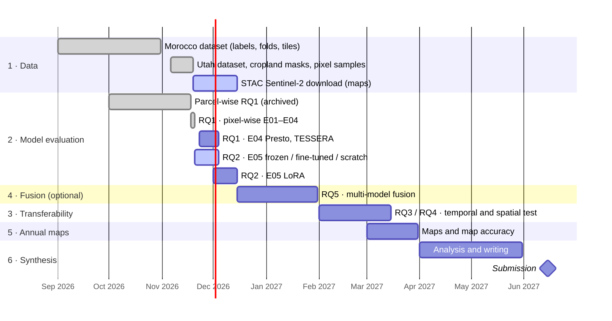

# Progress report

Where the research stands against the [research plan](research_plan.md) and the [research proposal](assets/research_proposal.pdf): what is
finished, what came out, what is next and what is still open. Every individual change is in the
[change log](progress.md).

*Last updated: 20 November 2026*

## Summary

The study now classifies **every 10 m pixel** as irrigated, rainfed or not cropland, so that the trained model can
map the whole cropland area ([D16](decisions.md#d16-pixel-wise-classification-for-continuous-maps)); the earlier
parcel-wise experiments are [archived](archive/index.md). Both study areas are ready: **Morocco** (2023/24 and
2024/25) and **Utah** (2023/24), with a cropland mask, labelled pixel samples and five spatial folds each.

**RQ1 is answered for four of the six foundation models** (E01–E04). In Morocco every model reaches a cropland
macro-F1 between 0.876 and 0.900 and no difference is significant. In Utah the frozen foundation models are clearly
better: TerraMind 0.797 against 0.729 for the random forest and 0.766 for U-TAE. **RQ2 has started:** E05 compares
Prithvi frozen, fully fine-tuned and trained from scratch with 10–100% of the labelled parcels (running on the
cluster); LoRA follows as a fourth strategy. Wall-to-wall Sentinel-2 composites for the maps are being downloaded
from STAC.

## Timeline

## Milestones

| Phase | Work package | Planned | Status | Output |
| --- | --- | --- | --- | --- |
| 1 | Data acquisition, ML-ready dataset (Morocco, Utah) | Sep – Nov 2026 | ✅ done | [Phase 1](phase1_data/overview.md) |
| 1 | Cropland mask and pixel samples | Nov 2026 | ✅ done | [Cropland mask](phase1_data/cropland_mask.md), [Pixel samples](phase1_data/pixel_samples.md) |
| 2 | Parcel-wise RQ1 benchmark | Sep – Nov 2026 | ✅ done, archived | [Archive](archive/index.md) |
| 2 | Pixel-wise RQ1 experiments E01–E04 | Nov 2026 | ✅ done (E04: 4 of 6 encoders; Presto, TESSERA to run) | [RQ1 · Experiment plan](phase2_models/experiment_plan.md) |
| 2 | Fine-tuning (RQ2): E05 frozen / LoRA / full fine-tuning / from scratch | Nov – Dec 2026 | ⏳ 12 jobs running, LoRA later | [E05](experiments/E05_prithvi_strategies.md), [RQ2 · Fine-tuning](phase2_models/fine_tuning.md) |
| 4 | Multi-model fusion (optional, RQ5) | Dec 2026 – Jan 2027 | 📝 | [Phase 4](phase4_fusion/index.md) |
| 2–4 | Comparative evaluation of the models | Feb 2027 | 📝 | |
| 3 | Temporal and spatial transferability (RQ3, RQ4) | Feb – Mar 2027 | 📝 Utah 2020/21 labels prepared for the temporal test | [Phase 3](phase3_transfer/index.md) |
| 5 | Annual irrigated maps | Mar 2027 | 🔄 STAC composites: Utah 2023/24 94% downloaded | [Phase 5](phase5_maps/index.md) |
| 6 | Analysis, writing, revision | Apr – May 2027 | 📝 | |
| 6 | Submission | Jun 2027 | 📝 | |

## Done so far

| Area | What | Where |
| --- | --- | --- |
| Labels | Morocco: 8,781 surveyed parcels (7,585 irrigated, 1,196 rainfed), 2023/24 and 2024/25. Utah: 6,013 WRLU 2024 fields (5,000 irrigated, 1,013 rainfed); 2021 for the temporal test | [Morocco](phase1_data/morocco.md), [Utah](phase1_data/utah.md) |
| Cropland mask | union of four products, third class "not cropland" | [Cropland mask](phase1_data/cropland_mask.md), [D17](decisions.md#d17-cropland-mask-from-four-products-and-a-not-cropland-class) |
| Pixel samples | inner pixels of the parcels (≤ 100 per parcel) and not-cropland pixels; Utah 654,382 labelled pixels in 2,405 tiles | [Pixel samples](phase1_data/pixel_samples.md) |
| Validation design | 5 spatial folds of 20 km blocks; PASTIS rotation (3 train / 1 validation / 1 test); every model scored on the same out-of-fold pixels | [Experiment plan](experiments/plan.md) |
| Experiments E01–E04 | random forest, gradient boosting, TempCNN, U-TAE and four frozen GeoFMs + L-TAE + UPerNet, both regions | [Experiments](experiments/index.md), [comparison](experiments/comparison.md) |
| E05 | Prithvi frozen / LoRA / full fine-tuning / from scratch, 10–100% of the parcels; code tested, 12 jobs running | [E05](experiments/E05_prithvi_strategies.md) |
| STAC download | monthly Sentinel-2 composites of every cropland tile from Earth Search; Utah 2023/24: 17,278 of 18,472 tiles | [`s2_download/`](https://github.com/amanchry/irrimapping-geofm/tree/main/s2_download) |
| Parcel-wise benchmark | frozen GeoFM embeddings + classifiers, E01–E05 of that set-up; kept as the archive | [Archive](archive/index.md) |
| Literature | GeoFM fine-tuning strategies, reference pages | [Reference papers](references/index.md), [RQ2 · Fine-tuning](phase2_models/fine_tuning.md) |

## Key results

Cropland macro-F1 (mean F1 of irrigated and rainfed), out of fold; "significant" means against the random forest
(95% block-bootstrap CI excludes 0 and Holm-corrected p < 0.05; details on the experiment pages):

| Experiment | Morocco | Utah |
| --- | --- | --- |
| [E01](experiments/E01_s2_pixel_baseline.md) · random forest | 0.876 | 0.729 |
| [E02](experiments/E02_temporal_nn.md) · TempCNN | 0.886 (not significant) | 0.721 (not significant) |
| [E03](experiments/E03_utae.md) · U-TAE from scratch | 0.897 (not significant) | 0.766 (significant) |
| [E04](experiments/E04_frozen_geofm.md) · best frozen GeoFM | 0.900 AgriFM (not significant) | 0.797 TerraMind (significant) |

- **Morocco:** all models within 0.876–0.900; no foundation model differs significantly from the random forest or
  U-TAE.
- **Utah:** the four frozen foundation models beat the random forest by 0.055–0.068; spatial context (U-TAE) adds
  +0.037 over the random forest.

All results: [Results](results.md).

## Next steps

1. **E05:** collect the 12 running jobs, run `report.py`, write the results; then the 4 LoRA jobs.
2. **E04 with Presto and TESSERA** in both regions; rerun the comparison table and paired tests.
3. **STAC download:** rerun the 78 missing Utah blocks; Morocco 2023/24 and 2024/25.
4. **RQ3 temporal test** (Utah 2020/21) with the best models; then the maps and the map accuracy sample.

## Open points and risks

| Point | Why it matters | Next action |
| --- | --- | --- |
| Prithvi pretrained on 30 m HLS, used at 10 m | its frozen features may be handicapped, so fine-tuning may gain more than for other encoders | stated in E05; compare with the other encoders' frozen scores |
| Decoder choice | Marti-Escofet et al. (2025) found UNet better than UPerNet for fine-tuned GeoFMs | keep UPerNet for comparability with PANGAEA; optional UNet check |
| No tuning per fine-tuning strategy | a strategy may be favoured by its settings | stated in E05; small learning-rate check if the differences are small |
| Validation complete at low label shares | low-share scores slightly optimistic for every strategy | stated in E05 |
| Region and year partly confounded in Morocco | a "hard region" may be a "hard year" | per-year results |
| Morocco differences not significant | wide CIs (0.09–0.14) from few, large spatial blocks | report CIs; rely on Utah for the clearer contrasts |
