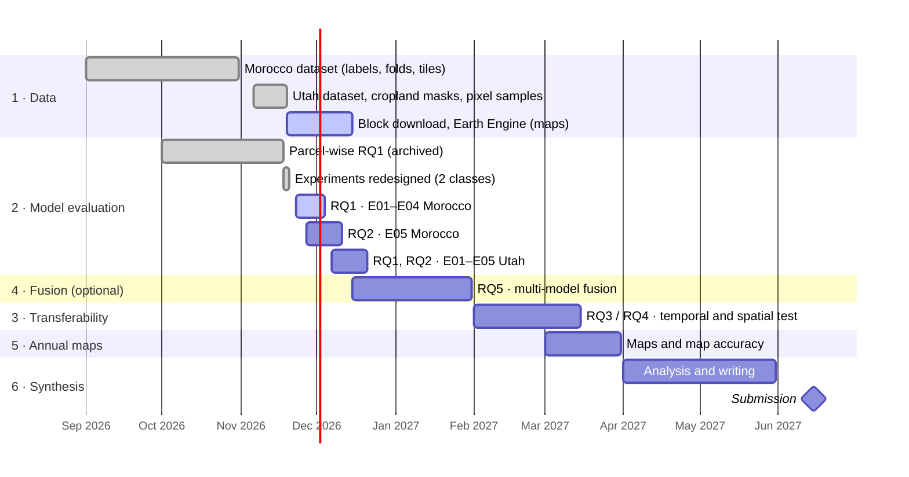

# Progress report

Where the research stands against the [research plan](research_plan.md) and the [research proposal](assets/research_proposal.pdf): what is
finished, what came out, what is next and what is still open. Every individual change is in the
[change log](progress.md).

*Last updated: 24 November 2026*

## Summary

The study classifies the **10 m pixels of the surveyed parcels as irrigated or rainfed**, so that the trained model
can later map the whole cropland area ([D16](decisions.md#d16-pixel-wise-classification-for-continuous-maps)); the
earlier parcel-wise experiments are [archived](archive/index.md). Both study areas are ready: **Morocco** (2023/24
and 2024/25) and **Utah** (2023/24), with labelled parcels, five spatial folds and tiles of 12 monthly Sentinel-2
composites.

**The experiments were redesigned on 20 November 2026** ([D19](decisions.md#d19-two-class-experiments-cropland-extent-in-the-mapping-phase)):
two classes (irrigated, rainfed) on the surveyed parcels only, no cropland mask and no weak "not cropland" class;
where cropland is becomes a question of the mapping phase (candidate masks: the union of four products, Dynamic
World). All earlier 3-class results were removed. E01–E05 are ready and tested and run again, **Morocco first**
(473,675 pixels of 8,775 parcels), then Utah. All imagery is now downloaded once per region and year on one grid
of 10.24 km blocks from Earth Engine; the training tiles are cut from these blocks and the maps will be predicted
from them, which replaces the STAC download ([D20](decisions.md#d20-download-once-on-1024-km-blocks-from-earth-engine-training-tiles-cut-from-them)).

On 24 November 2026 the code was reorganised into `data_download/` (all downloads, block grid,
`regions.py`) and `data_training_prep/` (labels, folds, tile plan, training tiles cut from the blocks). Tiles cut from a
downloaded block are identical to the existing training tiles, so these were not downloaded again. The block plan
covers every 10.24 km block of the mapping area (Morocco: 4,199 per year; 169 with training tiles in 2023/24, 65 in
2024/25); Dynamic World is downloaded for all of them as a binary cropland image, and
Sentinel-2 and Sentinel-1 follow only for blocks with cropland or with training tiles.

## Timeline

## Milestones

| Phase | Work package | Planned | Status | Output |
| --- | --- | --- | --- | --- |
| 1 | Data acquisition, ML-ready dataset (Morocco, Utah) | Sep – Nov 2026 | ✅ done | [Phase 1](phase1_data/overview.md) |
| 1 | Cropland mask and pixel samples | Nov 2026 | ✅ done | [Cropland mask](phase1_data/cropland_mask.md), [Pixel samples](phase1_data/pixel_samples.md) |
| 2 | Parcel-wise RQ1 benchmark | Sep – Nov 2026 | ✅ done, archived | [Archive](archive/index.md) |
| 2 | Pixel-wise RQ1 experiments E01–E04 (2 classes) | Nov – Dec 2026 | ⏳ ready; Morocco first, then Utah | [RQ1 · Experiment plan](phase2_models/experiment_plan.md) |
| 2 | Fine-tuning (RQ2): E05 frozen / LoRA / full fine-tuning / from scratch | Nov – Dec 2026 | ⏳ ready; Morocco first, then Utah | [E05](experiments/E05_prithvi_strategies.md), [RQ2 · Fine-tuning](phase2_models/fine_tuning.md) |
| 4 | Multi-model fusion (optional, RQ5) | Dec 2026 – Jan 2027 | 📝 | [Phase 4](phase4_fusion/index.md) |
| 2–4 | Comparative evaluation of the models | Feb 2027 | 📝 | |
| 3 | Temporal and spatial transferability (RQ3, RQ4) | Feb – Mar 2027 | 📝 Utah 2020/21 labels prepared for the temporal test | [Phase 3](phase3_transfer/index.md) |
| 5 | Annual irrigated maps | Mar 2027 | 🔄 block download from Earth Engine tested on one Morocco block; STAC route retired ([D20](decisions.md#d20-download-once-on-1024-km-blocks-from-earth-engine-training-tiles-cut-from-them)) | [Phase 5](phase5_maps/index.md) |
| 6 | Analysis, writing, revision | Apr – May 2027 | 📝 | |
| 6 | Submission | Jun 2027 | 📝 | |

## Done so far

| Area | What | Where |
| --- | --- | --- |
| Labels | Morocco: 8,781 surveyed parcels (7,585 irrigated, 1,196 rainfed), 2023/24 and 2024/25. Utah: 6,013 WRLU 2024 fields (5,000 irrigated, 1,013 rainfed); 2021 for the temporal test | [Morocco](phase1_data/morocco.md), [Utah](phase1_data/utah.md) |
| Cropland mask (mapping phase) | union of four products per year; Dynamic World cropland as the alternative, which selects the blocks and tiles of the download and the maps | [Cropland mask](phase1_data/cropland_mask.md), [D19](decisions.md#d19-two-class-experiments-cropland-extent-in-the-mapping-phase) |
| Pixel samples | inner pixels of the parcels (≤ 100 per parcel) and not-cropland pixels; Utah 654,382 labelled pixels in 2,405 tiles | [Pixel samples](phase1_data/pixel_samples.md) |
| Validation design | 5 spatial folds of 20 km blocks; PASTIS rotation (3 train / 1 validation / 1 test); every model scored on the same out-of-fold pixels | [Experiment plan](experiments/plan.md) |
| Experiments E01–E04 | random forest, gradient boosting, TempCNN, U-TAE and six frozen GeoFMs + L-TAE + UPerNet; 2-class code ready and tested | [Experiments](experiments/index.md), [comparison](experiments/comparison.md) |
| E05 | Prithvi frozen / LoRA / full fine-tuning / from scratch, 10–100% of the parcels; code ready and tested | [E05](experiments/E05_prithvi_strategies.md) |
| Wall-to-wall download | one grid of 10.24 km blocks per region and year (Earth Engine): Dynamic World for every block of the mapping area, Sentinel-2 and Sentinel-1 for the blocks with cropland (≥ 164 Dynamic World cropland pixels) or with training tiles; tested on one Morocco block (2023/24: Sentinel-2 159 MB in 164 s, Sentinel-1 82 MB in 92 s, binary Dynamic World cropland in about 6 s); training tiles cut from the blocks are identical to the existing ones. Replaces the STAC download (Utah 2023/24 had reached 17,278 of 18,472 tiles) | [`data_download/`](https://github.com/amanchry/irrimapping-geofm/tree/main/data_download), [D20](decisions.md#d20-download-once-on-1024-km-blocks-from-earth-engine-training-tiles-cut-from-them) |
| Parcel-wise benchmark | frozen GeoFM embeddings + classifiers, E01–E05 of that set-up; kept as the archive | [Archive](archive/index.md) |
| Literature | GeoFM fine-tuning strategies, reference pages | [Reference papers](references/index.md), [RQ2 · Fine-tuning](phase2_models/fine_tuning.md) |

## Key results

_None yet in the two-class design_ (the earlier 3-class results were removed; [Results](results.md)).

## Next steps

1. **Morocco:** E01, E02, E03, then E04 (six encoders) and E05 (16 jobs) on the cluster; comparison and paired tests.
2. **Utah:** rebuild the 2-class pixel samples on the cluster, then the same experiments.
3. **Block download:** Dynamic World for all planned blocks, then Sentinel-2 and Sentinel-1 for the cropland and training blocks, of Morocco (2023/24, 2024/25) and Utah (2023/24, 2020/21) on the cluster.
4. **Mapping phase:** compare candidate cropland masks (union of products, Dynamic World) on the surveyed parcels.

## Open points and risks

| Point | Why it matters | Next action |
| --- | --- | --- |
| Prithvi pretrained on 30 m HLS, used at 10 m | its frozen features may be handicapped, so fine-tuning may gain more than for other encoders | stated in E05; compare with the other encoders' frozen scores |
| Decoder choice | Marti-Escofet et al. (2025) found UNet better than UPerNet for fine-tuned GeoFMs | keep UPerNet for comparability with PANGAEA; optional UNet check |
| No tuning per fine-tuning strategy | a strategy may be favoured by its settings | stated in E05; small learning-rate check if the differences are small |
| Validation complete at low label shares | low-share scores slightly optimistic for every strategy | stated in E05 |
| Region and year partly confounded in Morocco | a "hard region" may be a "hard year" | per-year results |
| Morocco differences not significant | wide CIs (0.09–0.14) from few, large spatial blocks | report CIs; rely on Utah for the clearer contrasts |
