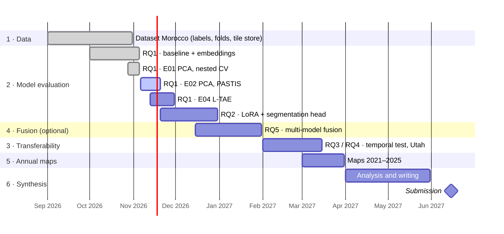

# Progress report

Where the research stands against the [research plan](research_plan.md) and the [research proposal](assets/research_proposal.pdf): what is
finished, what came out, what is next and what is still open. Every individual change is in the
[change log](progress.md).

*Last updated: 6 November 2026*

## Summary

The **dataset is complete**: 8,781 field-surveyed parcels with Sentinel-1/2 time series of their agricultural year,
five spatial folds and a shared tile store. **Embeddings of all four foundation models** are computed. The **first
RQ1 experiment** shows that no frozen foundation model beats a well-designed Sentinel-1/2 baseline on average
(macro-F1 0.910 for the best pair vs 0.906), while Clay and Prithvi hold up better in the hardest region. The main RQ1
run with the final validation design is ready, and a second way of combining the months (L-TAE) is planned. The
experiment setup, documentation and website are in place, so every result can be rerun and traced.

## Timeline

## Milestones

| Phase | Work package | Planned | Status | Output |
| --- | --- | --- | --- | --- |
| 1 | Data acquisition, ML-ready dataset | Sep 2026 | ✅ done | [Phase 1](phase1_data/overview.md) |
| 2 | Sentinel-based baseline | Sep 2026 | ✅ done | baseline in [E01](experiments/E01_frozen_pca_nested/report.md) |
| 2 | Foundation-model embeddings | Sep – Oct 2026 | ✅ done (AgriFM scaling to confirm) | [RQ1 · Frozen encoders](phase2_models/frozen_encoders.md) |
| 2 | Frozen-encoder experiments (RQ1) | Sep – Oct 2026 | ⏳ E01 done · E02 running · E04 planned | [Experiments](experiments/index.md) |
| 2 | Parameter-efficient fine-tuning, LoRA (RQ2) | Nov – Dec 2026 | 📝  | [RQ2 · Fine-tuning](phase2_models/fine_tuning.md) |
| 4 | Full fine-tuning, multi-model fusion (optional, RQ5) | Dec 2026 – Jan 2027 | 📝 | [Phase 4](phase4_fusion/index.md) |
| 2–4 | Comparative evaluation of the models | Feb 2027 | 📝 | |
| 3 | Temporal test and second region (RQ3, RQ4) | Feb – Mar 2027 | 🔄 Utah dataset in preparation ([D13](decisions.md#d13-utah-as-a-second-independent-study-area)) | [Phase 3](phase3_transfer/index.md) |
| 5 | Annual irrigated maps 2021–2025 | Mar 2027 | 📝 | [Phase 5](phase5_maps/index.md) |
| 6 | Analysis, writing, revision | Apr – May 2027 | 📝 | |
| 6 | Submission | Jun 2027 | 📝 | |

## Done so far

| Area | What | Where |
| --- | --- | --- |
| Labels | 8,781 cropland parcels (7,585 irrigated, 1,196 rainfed), each with its own agricultural year (2023/24 or 2024/25) | [Dataset §4](phase1_data/morocco.md) |
| Validation design | 5 spatial folds of 20 km blocks; PASTIS rotation (3 train / 1 validation / 1 test) | [Protocol §2](phase2_models/evaluation.md#2-spatial-splits) |
| Image store | 2,987 non-overlapping 128 px tiles, 12 monthly composites × 19 bands (Sentinel-2 with Cloud Score+, Sentinel-1) | [Dataset §6](phase1_data/morocco.md) |
| Model inputs | parcel features (baseline) and patch-aligned 64 px chips for the foundation models | [Dataset §7](phase1_data/morocco.md) |
| Embeddings | Clay v1.5, Prithvi-EO-2.0, TerraMind, AgriFM for every parcel and month | [Models pipeline](phase2_models/frozen_encoders.md) |
| First RQ1 result | E01: four classifiers on every input, block-bootstrap confidence intervals | [E01 report](experiments/E01_frozen_pca_nested/report.md) |
| Reproducibility | every result from a config file; reports generated; documentation website | [Experiments](experiments/index.md) |
| Literature | GeoFM heads, neural baselines, mapping requirements; reference list | [Reference papers](references/index.md) |
| Transfer data | US state datasets checked: eastern Washington and Utah have irrigated and dryland fields | [Data sources](data_source/index.md) |

## Key results

| Experiment | Result |
| --- | --- |
| [E01](experiments/E01_frozen_pca_nested/report.md) · frozen GeoFMs + PCA, nested CV | No GeoFM beats the S1/S2 baseline after correcting for multiple tests (best Clay + SVM 0.910 vs baseline + SVM 0.906). Linear probe: TerraMind and Clay equal the baseline. AgriFM is behind. In the hardest fold (rainfed in Doukkala and Souss) the baseline drops to 0.80 while Clay and Prithvi stay higher. |

All results: [Results](results.md).

## Next steps

1. Run [E02](experiments/E02_frozen_pca/index.md): the main RQ1 result.
2. Confirm AgriFM's input normalisation; re-embed if needed.
3. Write the L-TAE pipeline (`models_run/03c_train_ltae.py`) and run [E04](experiments/E04_frozen_ltae/index.md).
4. Results per region and per season from the out-of-fold predictions.
5. Start RQ2: segmentation head (UPerNet) and LoRA fine-tuning; neural baselines TempCNN and U-TAE.

## Open points and risks

| Point | Why it matters | Next action |
| --- | --- | --- |
| AgriFM pixel scale (its config mean ~4,180 vs ~1,100 in Earth Engine Sentinel-2) | AgriFM may be under-rated in E01 | check the scale its weights expect |
| Prithvi pretrained on 30 m HLS, used at 10 m | possible handicap | state it; optional 30 m test |
| Neighbouring fields inside a chip | mixed patches for small parcels | accuracy by parcel size; optional masked-chip test |
| Region and year partly confounded | a "hard region" may be a "hard year" | per-year results; year test within Doukkala / El Haouz |
| Second region (RQ4) | Tunisia has only 10 rainfed reference points | decided: Utah as an independent second study area with its own labels ([D13](decisions.md#d13-utah-as-a-second-independent-study-area)); wording of RQ3 / RQ4 to agree with the supervisors |
| Wall-to-wall mapping (RQ3) | parcel pooling needs polygons | segmentation head and pixel models ([D11](decisions.md#d11-two-kinds-of-head-parcel-benchmark-and-mapping-model)) |
