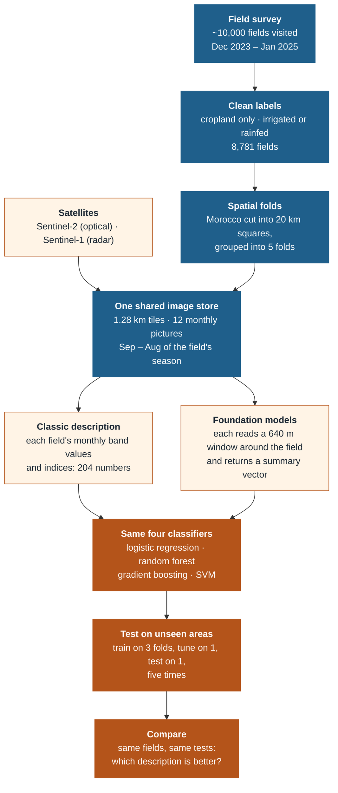

# 2 · The method in plain language

The question in one line: **is a field irrigated or rainfed?**, and does a pretrained foundation model answer it
better than the classic way of describing a field by its monthly satellite values?

> **One field, one label.** A surveyor visited each field and recorded whether it is irrigated. The model's job is
> to give the same answer from satellite images alone, for fields in areas it has never seen.

---

## The chain

## Step by step

**1. Labels.** The Moroccan field survey (Ouassanouan et al. 2026) records crop and irrigation method for each
field. Every cropland field becomes *irrigated* (flood, sprinkler, drip, pivot …) or *rainfed*. Rainfed fields are
only 14% of the data, so every score treats both classes as equally important.

**2. Spatial folds.** Neighbouring fields look alike. If a test field has a training field next door, the model
can look good without having learnt anything general. So the country is cut into 20 km squares and whole squares
are kept together in one of five folds. A model is always tested on squares it never saw.

**3. One image store for every model.** For each field's agricultural year (September to August) the images are
averaged into 12 monthly pictures: Sentinel-2 bands with clouds removed, and Sentinel-1 radar. They are cut into a
fixed grid of 1.28 km tiles that do not overlap. The baseline and every foundation model read exactly these
pixels, so differences come from the method, not the data.

**4. Two ways to describe a field.**
- *Classic:* the median of the field's pixels for each band, three vegetation and water indices and the radar,
  for each of the 12 months: 204 numbers. Months that were fully cloudy are filled from the months around them.
- *Foundation model:* a 64 × 64-pixel window (640 m) around the field goes into the frozen model. It returns a
  vector for each small patch; the patches that cover the field are averaged, weighted by how much of each patch is
  inside the field. Clay, Prithvi and TerraMind do this for each month; AgriFM reads the whole year at once.

**5. From 12 months to one vector.** A foundation model gives up to 12 × 1,024 numbers per field. Two ways to
combine the months are tested:
- *PCA pipeline:* put the 12 months side by side and compress them to 128 numbers (PCA learnt on the training
  folds only).
- *L-TAE pipeline (next):* a small attention network learns which months matter, as in the PANGAEA benchmark.

**6. Classifiers.** The same four classifiers are trained on every description, each with a small set of settings
to choose from. Logistic regression on frozen embeddings is the standard "linear probe": it shows what the
encoder already knows.

**7. Testing.** Five rounds: three folds train, the next fold picks the best setting, the remaining fold is the
test. After five rounds every field has been predicted once, by a model that never saw its area.

**8. Comparing.** All inputs are scored on the same fields. Uncertainty comes from re-drawing whole 20 km squares
1,000 times; the same draws are used for every input, so differences are measured fairly. A model counts as
better only if the difference is clearly above zero after correcting for the number of comparisons.

## What the results can and cannot say

- They say how well each description maps **new areas inside the surveyed regions** of Morocco.
- They do not yet say how a model does **in another year** or **in another country**: that is RQ3 and RQ4.
- Region and year overlap in the survey (Gharb and Tadla only 2023/24, Souss only 2024/25), so a "hard region"
  may partly be a "hard year".

