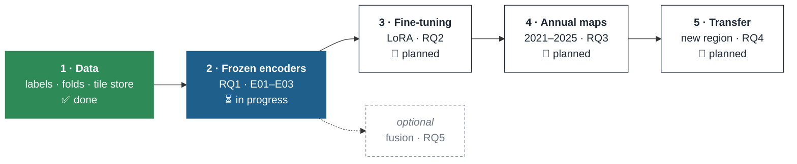

# 1 · Thesis design

**Evaluating Geospatial Foundation Models for Irrigated Cropland Mapping in North Africa and Their
Transferability to Data-Scarce Regions**

Aman Chaudhary · MSc Geo-Information Science and Earth Observation (M-GEO), GeoAI, 2025–2027 · ITC, University of
Twente · Supervisors: Dr. Mahdi Farnaghi, Prof. Dr. Raúl Zurita Milla

The research design follows the [thesis proposal](https://github.com/amanchry/irrimapping-geofm/blob/main/thesis_proposal/MScProposal_s3677133_AmanChaudhary.pdf).
Where the implementation departs from it, the change and its reason are in [Decisions](decisions.md).

---

## Why

Irrigated land is about 20% of the world's cropland but gives about 40% of its food and takes about 70% of
freshwater withdrawals. Morocco is among the most water-stressed countries, has expanded drip irrigation fast, and
has no annual irrigated-cropland maps. Global products are coarse or static. Geospatial foundation models (GeoFMs)
are pretrained on large unlabelled archives and promise good maps from few labels and better transfer to new regions,
but **none has been evaluated for irrigated cropland mapping**.

## Aim

To compare the performance and transferability of geospatial foundation models for irrigated cropland mapping.

## Research questions and where they stand

| RQ | Question | Experiments | Status |
| --- | --- | --- | --- |
| **RQ1** | What accuracy does each foundation model achieve for irrigated vs rainfed mapping across Morocco's agricultural regions, and how does it compare with a conventional Sentinel-based classifier? | [E01](../experiments/E01_frozen_pca_nested/index.md), [E02](../experiments/E02_frozen_pca_pastis/index.md), [E03](../experiments/E03_frozen_ltae_pastis/index.md) | ⏳ in progress: first result in, main run ready |
| **RQ2** | How much does parameter-efficient fine-tuning (LoRA) improve on a frozen encoder? | – | 📝 planned (Nov – Dec 2026) |
| **RQ3** | How temporally consistent is the best model across years, and does the annual map series for Morocco follow reported irrigation trends? | – | 📝 planned |
| **RQ4** | How does accuracy degrade when the Morocco-trained model is applied without retraining to another region? | – | 📝 planned; transfer region under review ([D10](decisions.md#d10-transfer-region-under-review)) |
| RQ5 *(optional)* | Does fusing embeddings of several GeoFMs improve on the best single model? | – | optional |

## Study area and data

| | |
| --- | --- |
| **Study area** | Five agricultural regions of Morocco: El Gharb, Tadla, Doukkala, El Haouz, Souss (plus 148 parcels recorded as zone "Statte" in the survey) |
| **Labels** | Field-surveyed parcels (Ouassanouan et al. 2026, *Scientific Data*): after cleaning **8,781 parcels**, 7,585 irrigated and 1,196 rainfed, surveyed Dec 2023 – Jan 2025 |
| **Imagery** | Sentinel-2 L2A (Cloud Score+ masking) and Sentinel-1 GRD (VV, VH), 12 monthly composites per agricultural year (Sep – Aug), 10 m |
| **Seasons** | Each parcel uses its own survey season: 2023/24 or 2024/25 |
| **Unit** | the parcel: one label per field, all metrics per parcel |

Details: [Part 1 · Dataset](../dataset/index.md).

## Models compared

| Model | Type | Input used here | Why it is in the study |
| --- | --- | --- | --- |
| **S1/S2 baseline** | hand-built features + classifier | 17 variables × 12 months | the conventional method the GeoFMs must beat |
| **Clay v1.5** | ViT masked autoencoder, any sensor | 10 S2 bands, per month | open, sensor-flexible MAE |
| **Prithvi-EO-2.0** (300M-TL) | multi-temporal ViT MAE, HLS | 6 bands, 4 months per pass | explicit time and location encoding |
| **TerraMind** 1.0 base | any-to-any multimodal | 12 S2 bands + S1 VV, VH | the only one pretrained with radar |
| **AgriFM** | Video Swin, agriculture-specific | 10 S2 bands, whole year at once | built for crop mapping |

All four have open weights and take multi-temporal Sentinel input, and together they cover the main GeoFM
architectures (proposal §1.3).

## Phases

| Period | Work (proposal plan) | Status |
| --- | --- | --- |
| Sep 2026 | Data acquisition, benchmark dataset, Random Forest baseline | ✅ done (dataset finished end of October) |
| Sep – Oct 2026 | Foundation-model embeddings, frozen-encoder experiments | ⏳ E01 done; E02 ready; E03 planned |
| Nov – Dec 2026 | Parameter-efficient fine-tuning (LoRA) | 📝 |
| Dec 2026 – Jan 2027 | Full fine-tuning (optional), multi-model fusion | 📝 |
| Feb 2027 | Comparative evaluation of the models | 📝 |
| Mar 2027 | Annual irrigated-cropland mapping 2021–2025, transferability | 📝 |
| Apr – May 2027 | Results analysis, thesis writing and revision | 📝 |
| Jun 2027 | Submission and defence | 📝 |

## Expected contribution

1. The first systematic evaluation of GeoFMs for irrigated cropland mapping in Africa, against a strong Sentinel
   baseline, under spatial validation.
2. Evidence on whether fine-tuning adds to frozen representations for this task.
3. Annual irrigated-cropland maps for Morocco and their consistency with national statistics.
4. A measure of how far the models transfer to a region without dense labels.
5. A reusable ML-ready dataset of irrigated and rainfed parcels (Part 1), publishable on its own.

