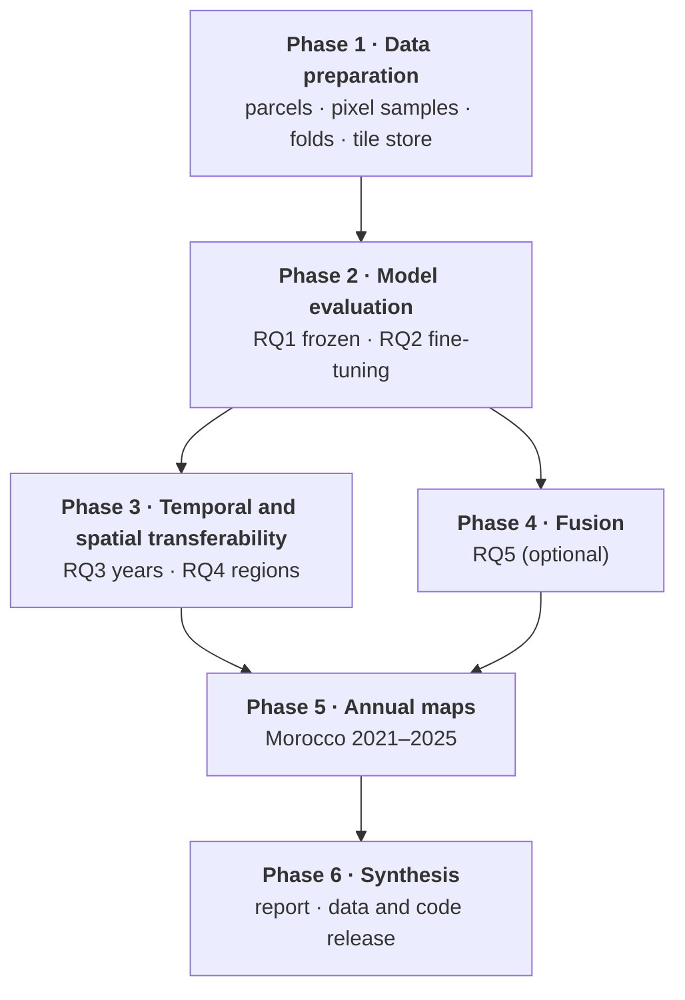

# Research plan

The study is organised in five phases that follow the objectives and research questions of the
[Introduction](introduction.md#objectives-and-research-questions), followed by a closing phase of synthesis and
dissemination. 

## Phases

| Phase | Aim | Objective · RQ | Main outputs | Period | Status |
| --- | --- | --- | --- | --- | --- |
| [**1 · Data preparation**](phase1_data/overview.md) | Build an ML-ready dataset of irrigated and rainfed parcels with spatial folds and a common image store, for Morocco and the second study area, Utah | basis for all RQs | labelled parcels, spatial folds, tile store, labelled pixel samples (outcome 6); cropland products and mask for the maps | Sep – Nov 2026 | ✅ Morocco · ⏳ Utah 2023/24 pixel samples to be rebuilt · 🔄 wall-to-wall block download (Earth Engine) |
| [**2 · Model evaluation**](phase2_models/overview.md) | Compare six foundation models with Sentinel-2 baselines for pixel-wise classification, frozen and fine-tuned, in Morocco and Utah | Objective 1 · RQ1, RQ2 | model comparison under spatial cross-validation; mapping model (outcomes 1, 2) | Sep 2026 – Jan 2027 | Morocco E01–E05 done (two classes); Utah next |
| [**3 · Temporal and spatial transferability**](phase3_transfer/index.md) | Assess how the best model performs in other years and whether the conclusions hold in a second region | Objective 2 · RQ3, RQ4 | temporal and spatial transfer accuracy (outcomes 4, 5) | Feb – Mar 2027 | 📝 planned |
| [**4 · Multi-model fusion**](phase4_fusion/index.md) | Test whether combining several foundation models improves on the best single model | Objective 3 (optional) · RQ5 | fused model and its comparison | Dec 2026 – Jan 2027 | 📝 optional |
| [**5 · Annual maps**](phase5_maps/index.md) | Choose the cropland mask, then produce and assess annual 10 m irrigated-cropland maps | Objective 2 · RQ3 (map series), RQ4 (second region) | maps 2021–2025 for Morocco (and Utah if time allows), checked against statistics and existing products (outcome 3) | Mar 2027 | 📝 planned |
| **6 · Synthesis and dissemination** | Comparative analysis, writing of the final report, release of dataset, code and maps | all | final report; public dataset, code and maps | Apr – Jun 2027 | 📝 |

Periods follow the work plan of the [research proposal](assets/research_proposal.pdf); the
[Progress report](progress_report.md) tracks them against the actual progress.

Phases 3 and 4 both build on the best model of Phase 2 and can proceed in parallel. Phase 5 uses the best model of
Phases 2–4.

## Additions to the proposal structure

The following components are not separate phases in the proposal but are required by the research questions; they
are assigned to a phase here.

| Component | Why it is needed | Phase |
| --- | --- | --- |
| **Pixel-wise classification** | Parcel polygons do not exist for wall-to-wall maps, so every model classifies 10 m pixels; this replaced the parcel benchmark and the separate mapping head of [D11](decisions.md#d11-two-kinds-of-head-parcel-benchmark-and-mapping-model) ([D16](decisions.md#d16-pixel-wise-classification-for-continuous-maps)) | 2 |
| **Second study area** | RQ4 requires reference labels outside Morocco; Utah (WRLU) became the second, independent study area ([D13](decisions.md#d13-utah-as-a-second-independent-study-area)) | 1 |
| **Year-transfer test** | Region and survey year are partly confounded in Morocco; RQ3 is tested in Utah, trained on 2023/24 and applied to 2020/21 ([D13](decisions.md#d13-utah-as-a-second-independent-study-area)) | 3 |
| **Wall-to-wall imagery** | the maps need composites of all cropland, downloaded once per region and year on 10.24 km blocks from Earth Engine (`data_download/`): Dynamic World for every block of the mapping area, Sentinel-2 and Sentinel-1 for the blocks with Dynamic World cropland or training tiles, from which the training tiles are also cut; the earlier STAC route was retired ([D20](decisions.md#d20-download-once-on-1024-km-blocks-from-earth-engine-training-tiles-cut-from-them)) | 1, 5 |
| **Cropland mask for the maps** | the experiments classify the surveyed parcels only (irrigated or rainfed), so the cropland extent of the maps and the handling of land that is not cropland are decided in the mapping phase (union of products vs Dynamic World, [Cropland extent and mask](phase1_data/cropland_mask.md)) | 5 |
| **Map accuracy and area assessment** | Map-based area totals are biased without an accuracy assessment against independent reference data | 5 |
| **Synthesis and dissemination** | Comparative evaluation, writing and the public release of dataset, code and maps | 6 |

## Organisation of the documentation

| Content | Location | Rule |
| --- | --- | --- |
| Phase pages | `docs/phase<N>_<name>/` with an `overview.md` (aim, RQs, design, status, links) and one page per component | a new component gets its own page in the phase folder |
| Experiments | one page per experiment, `docs/experiments/E0<N>_<name>.md`; code in `experiments/E0<N>_<name>/run.py` (settings at the top) | the page states the research question it answers |
| Shared references | [Foundation models](foundation_models/index.md), [Data sources](data_source/index.md), [Decisions](decisions.md) | one fact in one place; other pages link to it |
| Results | [Results](results.md) per research question | updated when an experiment finishes |
| Progress | [Progress report](progress_report.md), [Change log](progress.md), [Meeting notes](weekly/index.md) | updated with every change and before every meeting |
