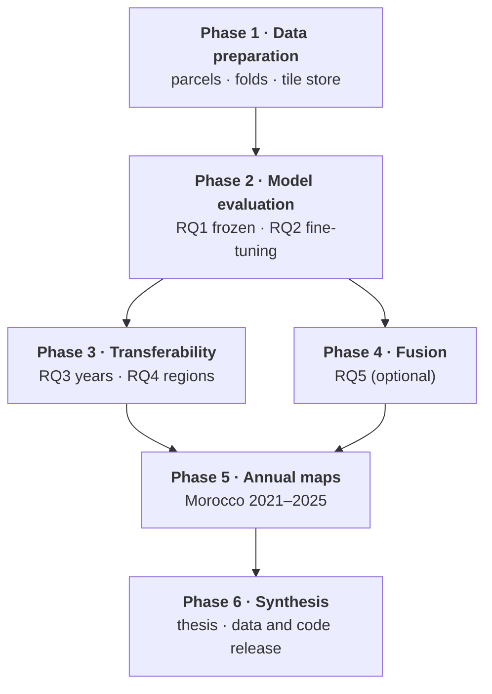

# Research plan

The study is organised in five phases that follow the objectives and research questions of the
[Introduction](introduction.md#objectives-and-research-questions), followed by a closing phase of synthesis and
dissemination. 

## Phases

| Phase | Aim | Objective · RQ | Main outputs | Period | Status |
| --- | --- | --- | --- | --- | --- |
| [**1 · Data preparation**](phase1_data/overview.md) | Build an ML-ready dataset of irrigated and rainfed parcels with spatial folds and a common image store; and the same for the second study area, Utah | basis for all RQs | labelled parcels, spatial folds, tile store, model inputs (outcome 6) | Sep – Oct 2026; Utah Nov 2026 | ✅ Morocco · 🔄 Utah |
| [**2 · Model evaluation**](phase2_models/overview.md) | Compare four foundation models with a Sentinel-2 baseline, frozen and fine-tuned, in Morocco | Objective 1 · RQ1, RQ2 | model comparison under spatial cross-validation; mapping model (outcomes 1, 2) | Sep 2026 – Jan 2027 | ⏳ RQ1 in progress |
| [**3 · Transferability**](phase3_transfer/index.md) | Assess how the best model performs in other years and in a region without training data | Objective 2 · RQ3, RQ4 | temporal and spatial transfer accuracy (outcomes 4, 5) | Feb – Mar 2027 | 📝 planned |
| [**4 · Multi-model fusion**](phase4_fusion/index.md) | Test whether combining several foundation models improves on the best single model | Objective 3 (optional) · RQ5 | fused model and its comparison | Dec 2026 – Jan 2027 | 📝 optional |
| [**5 · Annual maps**](phase5_maps/index.md) | Produce and assess annual 10 m irrigated-cropland maps | Objective 2 · RQ3 (map series), RQ4 (second region) | maps 2021–2025 for Morocco (and Utah if time allows), checked against statistics and existing products (outcome 3) | Mar 2027 | 📝 planned |
| **6 · Synthesis and dissemination** | Comparative analysis, thesis writing, release of dataset, code and maps | all | thesis; public dataset, code and maps | Apr – Jun 2027 | 📝 |

Periods follow the work plan of the [research proposal](assets/research_proposal.pdf); the
[Progress report](progress_report.md) tracks them against the actual progress.

Phases 3 and 4 both build on the best model of Phase 2 and can proceed in parallel. Phase 5 uses the best model of
Phases 2–4.

## Additions to the proposal structure

The following components are not separate phases in the proposal but are required by the research questions; they
are assigned to a phase here.

| Component | Why it is needed | Phase |
| --- | --- | --- |
| **Mapping model** (pixel-level head) | The RQ1 benchmark pools embeddings over parcel polygons, which do not exist for wall-to-wall maps ([D11](decisions.md#d11-two-kinds-of-head-parcel-benchmark-and-mapping-model)) | 2 (with RQ2) |
| **Transfer-region dataset** | RQ4 requires reference labels outside Morocco; the region is still to be chosen ([D10](decisions.md#d10-transfer-region-under-review)) | 1 (prepared at the start of Phase 3) |
| **Year-transfer test** | Region and survey year are partly confounded; RQ3 needs a test across agricultural years | 3 |
| **Map accuracy and area assessment** | Map-based area totals are biased without an accuracy assessment against independent reference data | 5 |
| **Synthesis and dissemination** | Comparative evaluation, writing and the public release of dataset, code and maps | 6 |

## Organisation of the documentation

| Content | Location | Rule |
| --- | --- | --- |
| Phase pages | `docs/phase<N>_<name>/` with an `overview.md` (aim, RQs, design, status, links) and one page per component | a new component gets its own page in the phase folder |
| Experiments | `docs/experiments/E<nn>_<name>/` (numbered across all phases) | `research_question` and `phase` in each `config.yaml` |
| Shared references | [Foundation models](foundation_models.md), [Data sources](data_source/index.md), [Decisions](decisions.md) | one fact in one place; other pages link to it |
| Results | [Results](results.md) per research question | updated when an experiment finishes |
| Progress | [Progress report](progress_report.md), [Change log](progress.md), [Meeting notes](weekly/index.md) | updated with every change and before every meeting |
