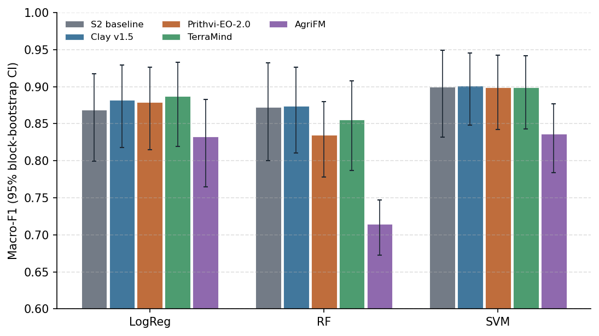
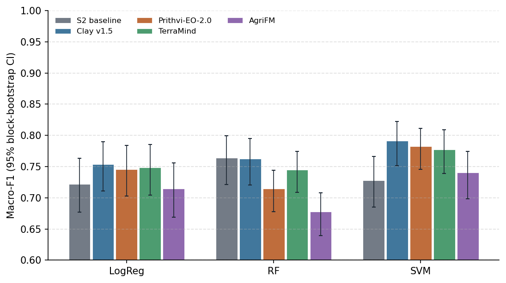
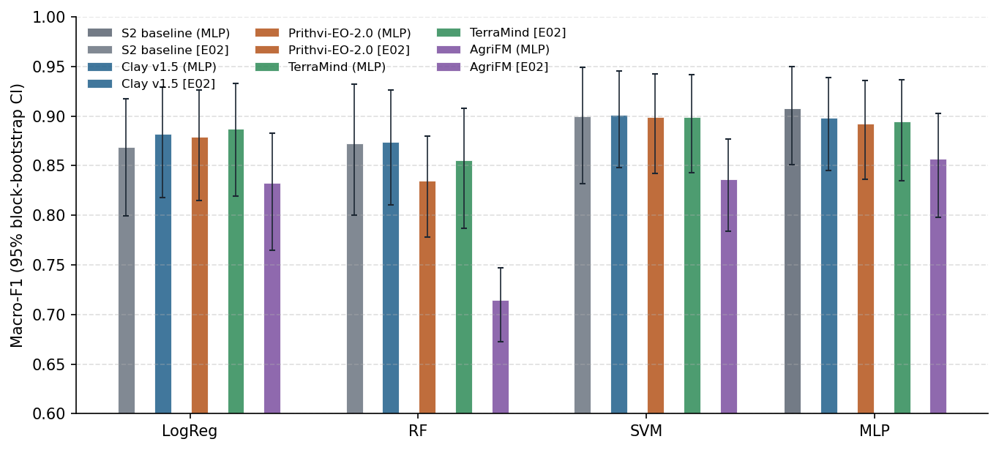
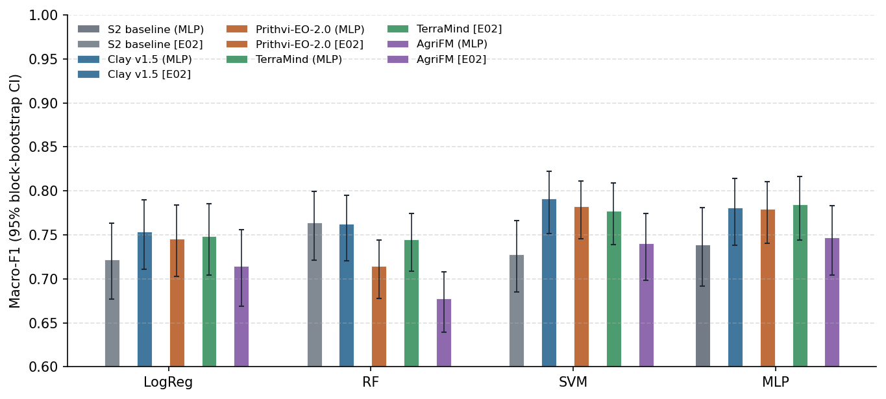

# Results

This page summarises the completed experiments in chronological order, each with its principal finding and main
figure. Full tables, per-fold results and caveats are given in the individual experiment reports. The list of all experiments, including those still to
run, is on the [Experiments](experiments/index.md) page.

## Where each research question stands

| Phase | RQ | Question (short) | Current answer | Evidence |
| --- | --- | --- | --- | --- |
| 2 | RQ1 | Do frozen GeoFMs beat a Sentinel-2 classifier? | **Not in Morocco; slightly in Utah.** Each input with its best head: Morocco S2 0.908 (MLP) vs Clay 0.901 (SVM); Utah Clay 0.791 (SVM) vs S2 0.764 (RF). A trained MLP head equals SVM but does not change the ranking. No label-efficiency advantage in Morocco; in Utah the GeoFMs need fewer labels. L-TAE (E04) and PSE-TAE (E05) still to run. | [E03](experiments/E03_frozen_pca_mlp/report.md) · [E02](experiments/E02_frozen_pca/report.md) · [E01](experiments/E01_frozen_pca_nested/report.md) |
| 2 | RQ2 | Does LoRA fine-tuning improve on the frozen encoders? | not started | – |
| 3, 5 | RQ3 | Is the best model consistent across years, and do the annual maps follow national statistics? | not started | – |
| 3, 5 | RQ4 | How far does accuracy degrade in another region? | not started | – |
| 4 | RQ5 | Does fusing several models improve on the best single model? | optional, not started | – |

## Finished experiments

<!-- AUTO:RESULTS:START -->
<!-- generated by experiments/make_report.py: do not edit between these markers -->

#### E01 · Frozen GeoFMs + PCA + classical classifiers (nested spatial CV)

Do frozen foundation-model embeddings separate irrigated from rainfed parcels better than Sentinel-1/2 features, with the same parcels, folds and classifiers?

- **Result:** best Clay v1.5 + SVM 0.910; best baseline SVM 0.906; 0 of 16 pairs better, 2 worse than the baseline (Holm).
- **Answer:** No frozen GeoFM beats the S1/S2 baseline (best Clay + SVM 0.910 vs 0.906, difference within the noise); Clay and Prithvi hold up better in the hardest fold.
- Full report: [E01 report](experiments/E01_frozen_pca_nested/report.md)

#### E02 · Frozen GeoFMs + PCA + classical classifiers

Do frozen foundation-model embeddings separate irrigated from rainfed parcels better than Sentinel-2 features, with the same parcels, folds and classifiers? (Sentinel-2 only for every input, D14)

- **Result:** Morocco: best Clay v1.5 + SVM 0.901; best baseline SVM 0.900; 0 of 12 pairs better, 2 worse than the baseline (Holm) · Utah 2023/24: best Clay v1.5 + SVM 0.791; best baseline RF 0.764; 4 of 12 pairs better, 2 worse than the baseline (Holm).
- **Answer:** Morocco: GeoFMs equal the S2 baseline (about 0.90 with SVM), AgriFM worse. Utah: Clay, Prithvi, TerraMind +0.05 to +0.06 with SVM; the best GeoFM (Clay SVM 0.791) is 0.03 above the baseline best head (RF 0.764).
- Full report: [E02 report](experiments/E02_frozen_pca/report.md)

#### E03 · Frozen GeoFMs + PCA + MLP head

Does a trainable neural head get more out of the same PCA input than logistic regression, random forest and SVM?

- **Result:** Morocco: best S2 baseline (MLP) + MLP 0.908; best baseline MLP 0.908; 0 of 4 pairs better, 1 worse than the baseline (Holm) · Utah 2023/24: best TerraMind (MLP) + MLP 0.785; best baseline MLP 0.739; 3 of 4 pairs better, 0 worse than the baseline (Holm).
- **Answer:** MLP head = SVM for every input, not better. Morocco: S2 + MLP best (0.908), GeoFMs 0.01-0.02 lower. Utah: GeoFMs + MLP beat S2 + MLP by 0.04-0.05, but S2 RF (E02) stays its best head.
- Full report: [E03 report](experiments/E03_frozen_pca_mlp/report.md)

<!-- AUTO:RESULTS:END -->

