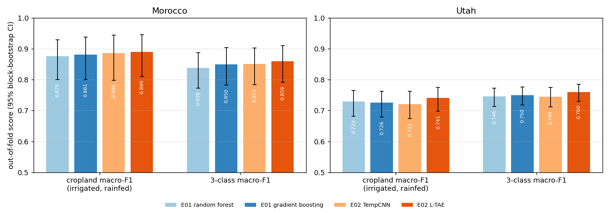

# Results

Results of the pixel-wise experiments, each with its principal finding and main figure. The list of all
experiments is on the [Experiments](experiments/index.md) page, all runs side by side on the
[comparison](experiments/comparison.md) page; the archived parcel-wise results are
[here](archive/parcel_wise_classification/results.md).

## Where each research question stands

| Phase | RQ | Question (short) | Current answer | Evidence |
| --- | --- | --- | --- | --- |
| 2 | RQ1 | Do frozen GeoFMs beat classifiers on the Sentinel-2 time series? | **Morocco: no significant difference** (cropland macro-F1 0.876 random forest – 0.900 AgriFM). **Utah: yes**, all four frozen GeoFMs beat the random forest by 0.055–0.068 (TerraMind 0.797 vs 0.729) and three of them beat U-TAE. Presto and TESSERA still to run | [E01](experiments/E01_s2_pixel_baseline.md)–[E04](experiments/E04_frozen_geofm.md) |
| 2 | RQ2 | Does fine-tuning (LoRA, full) beat the frozen encoder and training from scratch, and how does it depend on the number of labels? | E05 running in Utah (frozen, fine-tuned, from scratch; 2 of 12 runs finished); LoRA later | [E05](experiments/E05_prithvi_strategies.md) |
| 3, 5 | RQ3 | Is the best model consistent across years, and do the annual maps follow national statistics? | not started (Utah 2023/24 → 2020/21) | – |
| 3, 5 | RQ4 | Do the conclusions hold in a second region? | partly answered: E01–E04 run in Morocco and Utah, with a clearer gain for the GeoFMs in Utah | [E04](experiments/E04_frozen_geofm.md) |
| 4 | RQ5 | Does fusing several models improve on the best single model? | optional, not started | – |

## Finished pixel-wise experiments

Cropland macro-F1 (mean F1 of irrigated and rainfed), out of fold, with 95% block-bootstrap CIs and paired tests on
the experiment pages.

### E01 · Sentinel-2 pixel baseline

A per-pixel Sentinel-2 time series with a random forest reaches **0.876 in Morocco** and **0.729 in Utah**.
Irrigated pixels are well separated; the difficulty is the rainfed class, especially in Utah, and its confusion with
not cropland. These are the reference numbers for E02–E04. → [E01](experiments/E01_s2_pixel_baseline.md)

### E02 · Temporal neural network

TempCNN is on par with the random forest (0.886 Morocco, 0.721 Utah); neither difference is significant.
→ [E02](experiments/E02_temporal_nn.md)

### E03 · U-TAE from scratch

Spatial context helps in Utah: U-TAE reaches 0.766, significantly above the random forest (+0.037), mainly through
the rainfed class; in Morocco it is on par (0.897, not significant). → [E03](experiments/E03_utae.md)

### E04 · Frozen foundation models + decoder

In **Utah** all four frozen encoders improve on the random forest by 0.055–0.068 (0.784–0.797, best TerraMind) and
three of them on U-TAE by 0.025–0.031: pretraining adds to spatial context. In **Morocco** every model lies between
0.876 and 0.900, within the uncertainty of the spatial folds. → [E04](experiments/E04_frozen_geofm.md)

