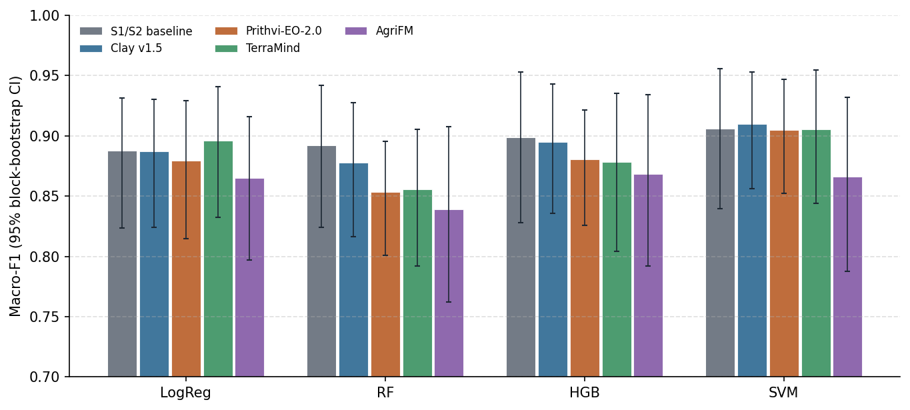

# Results

This page summarises the completed experiments in chronological order, each with its principal finding and main
figure. Full tables, per-fold results and caveats are given in the individual experiment reports. The list of all experiments, including those still to
run, is on the [Experiments](experiments/index.md) page.

## Where each research question stands

| Phase | RQ | Question (short) | Current answer | Evidence |
| --- | --- | --- | --- | --- |
| 2 | RQ1 | Do frozen GeoFMs beat a Sentinel-1/2 classifier? | **Not on average.** The best GeoFMs equal the baseline (macro-F1 ≈ 0.91); Clay and Prithvi hold up better in the hardest region. To be confirmed with the final validation design (E02) and the L-TAE pipeline (E04). | [E01](experiments/E01_frozen_pca_nested/report.md) |
| 2 | RQ2 | Does LoRA fine-tuning improve on the frozen encoders? | not started | – |
| 3, 5 | RQ3 | Is the best model consistent across years, and do the annual maps follow national statistics? | not started | – |
| 3, 5 | RQ4 | How far does accuracy degrade in another region? | not started | – |
| 4 | RQ5 | Does fusing several models improve on the best single model? | optional, not started | – |

## Finished experiments

<!-- AUTO:RESULTS:START -->
<!-- generated by experiments/make_report.py: do not edit between these markers -->

#### E01 · Frozen GeoFMs + PCA + classical classifiers (nested spatial CV)

Do frozen foundation-model embeddings separate irrigated from rainfed parcels better than Sentinel-1/2 features, with the same parcels, folds and classifiers?

- **Result:** best Clay v1.5 + SVM 0.910; best baseline SVM 0.906; 0 of 16 input-classifier pairs better, 2 worse than the baseline (Holm).
- **Answer:** No frozen GeoFM beats the S1/S2 baseline (best Clay + SVM 0.910 vs 0.906, difference within the noise); Clay and Prithvi hold up better in the hardest fold.
- Full report: [E01 report](experiments/E01_frozen_pca_nested/report.md)

<!-- AUTO:RESULTS:END -->

