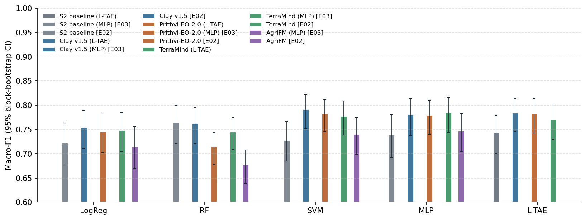

# Weeks 2026-W45–46 · RQ1 complete in two regions

**In one line:** frozen GeoFMs do not beat models trained only on our labels in Morocco (a tie at macro-F1 ≈ 0.91),
but Clay is ahead by a small, significant margin in Utah (0.79 vs 0.76). Neither the classifier head nor the temporal
aggregation changes this.

## 1. Done this week
- **Utah added as a second, independent study area** (WRLU 2024, agricultural year 2023/24; 2021 kept for a temporal
  test): the same pipeline as Morocco, with labels, spatial folds, tile store and model inputs
  → [Utah training data](../phase1_data/utah.md), [decision D13](../decisions.md#d13-utah-as-a-second-independent-study-area).
- **Sentinel-2 only for every input** (foundation models and baselines), so that all inputs use the same optical
  data and both regions are treated alike → [D14](../decisions.md#d14-sentinel-2-only-for-every-input).
- **Embeddings of all four GeoFMs for both regions** (Utah on the HPC cluster).
- **RQ1 experiment plan:** four experiments, each changing one thing. Each runs in both regions, with label efficiency
  (10/25/50% of the training blocks × 3 draws) inside every experiment
  → [experiment plan](../phase2_models/experiment_plan.md).
- **E02–E05 run on the cluster** (Slurm, about 300 GPU/CPU jobs in total), copied back with checksums. Every
  experiment has a report with tables, figures, how-to-read notes and an interpretation:
    - [E02](../experiments/E02_frozen_pca/report.md) · PCA + LogReg / RF / SVM
    - [E03](../experiments/E03_frozen_pca_mlp/report.md) · PCA + MLP head
    - [E04](../experiments/E04_frozen_ltae/report.md) · L-TAE temporal attention + MLP
    - [E05](../experiments/E05_psetae_scratch/report.md) · PSE-TAE trained from scratch (neural baseline)

## 2. Results

Best macro-F1 of each input over all heads of E02–E05 (out-of-fold, 5 spatial folds, same parcels per region):

| Input | Morocco | Utah 2023/24 |
| --- | ---: | ---: |
| S2 baseline (180 features) | 0.908 (MLP) | 0.764 (RF) |
| **PSE-TAE from scratch** (S2 pixels) | **0.911** | 0.755 |
| **Clay v1.5** | 0.906 (L-TAE) | **0.791** (SVM) |
| Prithvi-EO-2.0 | 0.899 (SVM) | 0.782 (SVM, L-TAE) |
| TerraMind | 0.899 (SVM) | 0.785 (MLP) |
| AgriFM | 0.857 (MLP) | 0.747 (MLP) |

- **Morocco: a tie.** PSE-TAE, S2 + MLP and Clay + L-TAE are all within ±0.01, and no difference is significant.
- **Utah: Clay is ahead.** Clay + SVM beats PSE-TAE by +0.036 [+0.015, +0.056]. The gain is largest in Bear River,
  the main rainfed zone (+0.05 to +0.09).
- **The head matters only until it is non-linear.** SVM, MLP and L-TAE give the same result for every input
  (within ±0.01). RF is weak on embeddings.
- **Temporal attention (L-TAE) adds nothing** over concatenating the 12 months and reducing them with PCA.
- **Label efficiency:** no advantage for the GeoFMs in Morocco. In Utah, Clay with 25% of the training blocks equals
  the S2 baseline with all blocks.
- **Correction of an early finding:** E02 suggested that the GeoFMs work better in Souss. E03 showed that this was an
  effect of the classical heads: with an MLP, the S2 features find 84% of the rainfed parcels there.
- **AgriFM is the weakest input:** it gives one embedding for the whole year, so the seasonal profile is lost.

<!-- ## 3. To discuss / decide
1. **How to state the RQ1 answer.** Proposal: compare each input with its best configuration ("best vs best") as the
   headline, and keep the per-head tables as robustness checks. Is this acceptable, or should one fixed head (e.g.
   the linear probe) be the headline?
2. **Is location a shortcut?** Clay and Prithvi receive the parcel's latitude/longitude. Ablation A4 (location
   switched off, re-embedding) tests whether Utah's gain comes from the image or from location. Run it before
   starting RQ2?
3. **Tuning the baseline.** PSE-TAE uses the settings of the original paper. Its training curves show the result is
   not limited by epochs or learning rate (best epoch ≈ 8, smooth loss). Is a small sensitivity grid in Utah needed
   to rule out an under-tuned baseline?
4. **RQ2 scope:** LoRA fine-tuning of Clay only (the best frozen model in both regions), or Clay and Prithvi? Which
   pixel-level head for the maps ([D11](../decisions.md#d11-two-kinds-of-head-parcel-benchmark-and-mapping-model))? -->

## 4. Next week
- [ ] **RQ1 summary:** best-vs-best comparison in the report generator (reproducible, Holm-corrected); update the
      progress page, research plan and Phase 2 overview.
- [ ] **Simple fine-tuning of Clay and Prithvi** (RQ2): the encoder is trained together with the head, with the same
      folds, parcels and evaluation as RQ1, so the results compare directly with E02–E05; mapping head
      ([D11](../decisions.md#d11-two-kinds-of-head-parcel-benchmark-and-mapping-model)); compute estimate.
- [ ] **LoRA fine-tuning** of the same models: only small low-rank adapters are trained and the encoder weights stay
      frozen. Compare it with full fine-tuning and the frozen encoders (accuracy, training time, memory).
<!-- - [ ] **Why do the head and the temporal aggregation add so little?** Explain why SVM, MLP and L-TAE give the same
      result (E02–E04). For example: how much of the class signal a linear probe already captures, how separable the
      classes are in the embedding space, and how far the attention weights are from uniform. -->

## 5. Notes from the meeting
_To be filled in after the meeting._
