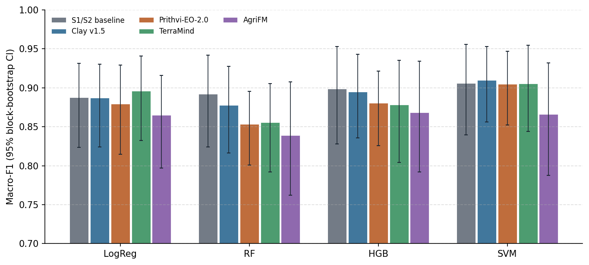
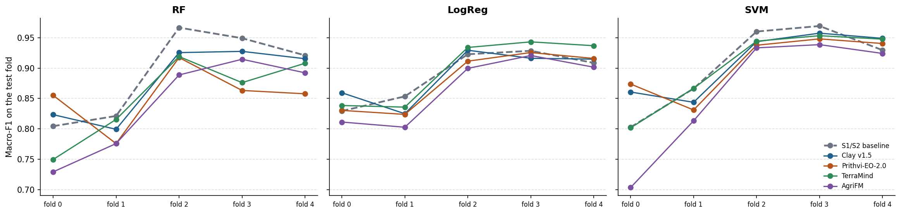

# Week 2026-W45 · first RQ1 result

**In one line:** the frozen foundation models reach the accuracy of the Sentinel-1/2 baseline but do not beat it
on average (macro-F1 ≈ 0.91); in the hardest region Clay and Prithvi hold up better than the baseline.

## 1. Done this week
- **First complete RQ1 experiment** on the final dataset (shared 128 px tile store, patch-aligned chips, 8,775
  parcels, 5 spatial folds): baseline + 4 GeoFMs × 4 classifiers →
  [E01 report](../experiments/E01_frozen_pca_nested/report.md).
- **Validation design fixed:** PASTIS rotation (3 folds train, next fold validation, 1 fold test) for every model,
  classical and neural → [decision D3](../research/decisions.md#d3-validation-pastis-rotation-instead-of-nested-cv).
  E01 used the earlier nested design; [E02](../experiments/E02_frozen_pca_pastis/index.md) repeats it with the
  final design.
- **Reproducible experiments:** every run now comes from a config file in [experiments/](../experiments/index.md)
  and writes its report; any result can be rerun with one command.
- **Documentation:** [thesis design](../research/thesis_design.md), [overview](../research/overview.md),
  [evaluation protocol](../research/protocol.md), [decisions](../research/decisions.md), [results](../results.md).
- **Literature:** PANGAEA (how GeoFM benchmarks handle time series), PASTIS (fold rotation), IrrMap (US irrigation
  data) → [literature notes](../research/literature.md).
- **Transfer data check (US):** of the downloaded state datasets, eastern Washington (WSDA) and Utah (WRLU) contain
  both irrigated and dryland fields; the USGS and Colorado data are irrigated-only
  → [decision D10](../research/decisions.md#d10-transfer-region-under-review).

## 2. Results (E01)

| Input | LogReg | RF | HGB | SVM |
| --- | ---: | ---: | ---: | ---: |
| S1/S2 baseline | 0.887 | **0.892** | **0.899** | 0.906 |
| Clay v1.5 | 0.887 | 0.878 | 0.895 | **0.910** |
| Prithvi-EO-2.0 | 0.880 | 0.853 | 0.881 | 0.905 |
| TerraMind | **0.896** | 0.856 | 0.878 | 0.905 |
| AgriFM | 0.865 | 0.839 | 0.868 | 0.866 |

Macro-F1, out-of-fold, same 8,775 parcels.

- **No GeoFM is significantly better than the baseline** with any classifier. Clay + SVM (0.910) and the baseline
  + SVM (0.906) are level.
- **Linear probe:** TerraMind and Clay equal the baseline, so the frozen embeddings already hold the irrigated /
  rainfed signal.
- **Random forest suits embeddings least;** AgriFM is behind (its input scaling is still to be checked).
- **Hardest region (fold 0, rainfed fields in Doukkala and Souss):** baseline 0.80; Prithvi 0.87 and Clay 0.86 (SVM).

## 3. To discuss / decide
1. **Headline classifier.** Keep RF (as in the proposal) plus the linear probe as headline, and report HGB / SVM as
   robustness checks? SVM is the best classifier for every input.
2. **Temporal aggregation.** Add the L-TAE pipeline (E03, as in PANGAEA) next to the PCA pipeline, before starting
   LoRA fine-tuning?
3. **Transfer region (RQ4).** Tunisia has 10 rainfed validation points; eastern Washington / Utah would give
   thousands and several years. Decide after RQ1–RQ2?

## 4. Next week
- [ ] Run [E02](../experiments/E02_frozen_pca_pastis/index.md) (PASTIS validation): the main RQ1 result.
- [ ] Check AgriFM's input normalisation; re-embed if needed.
- [ ] Write `models_run/03c_train_ltae.py` and run [E03](../experiments/E03_frozen_ltae_pastis/index.md).
- [ ] Results per region and per season from the out-of-fold predictions.

## 5. Notes from the meeting
_To be filled in after the meeting._
