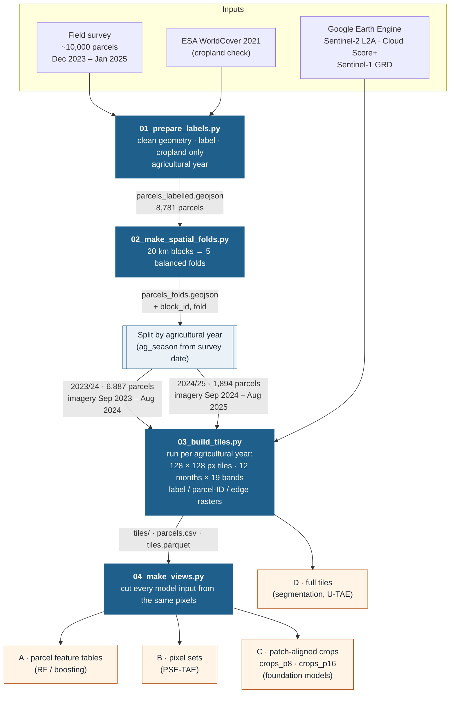
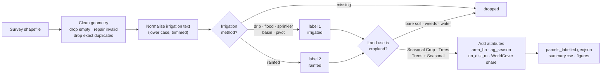
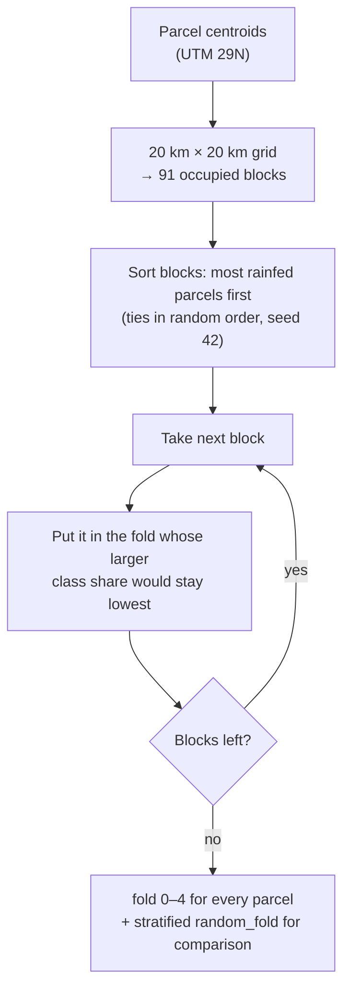
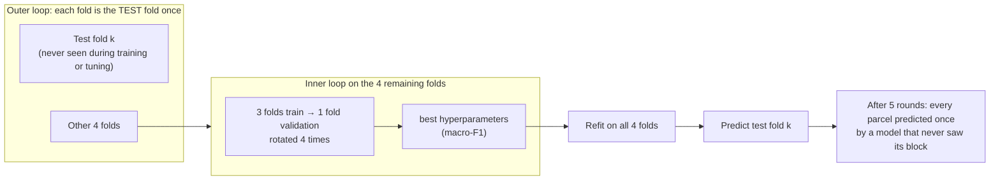
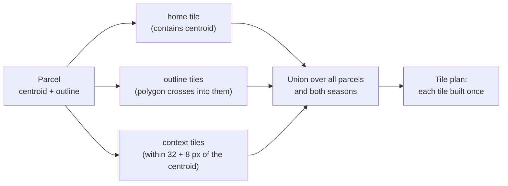
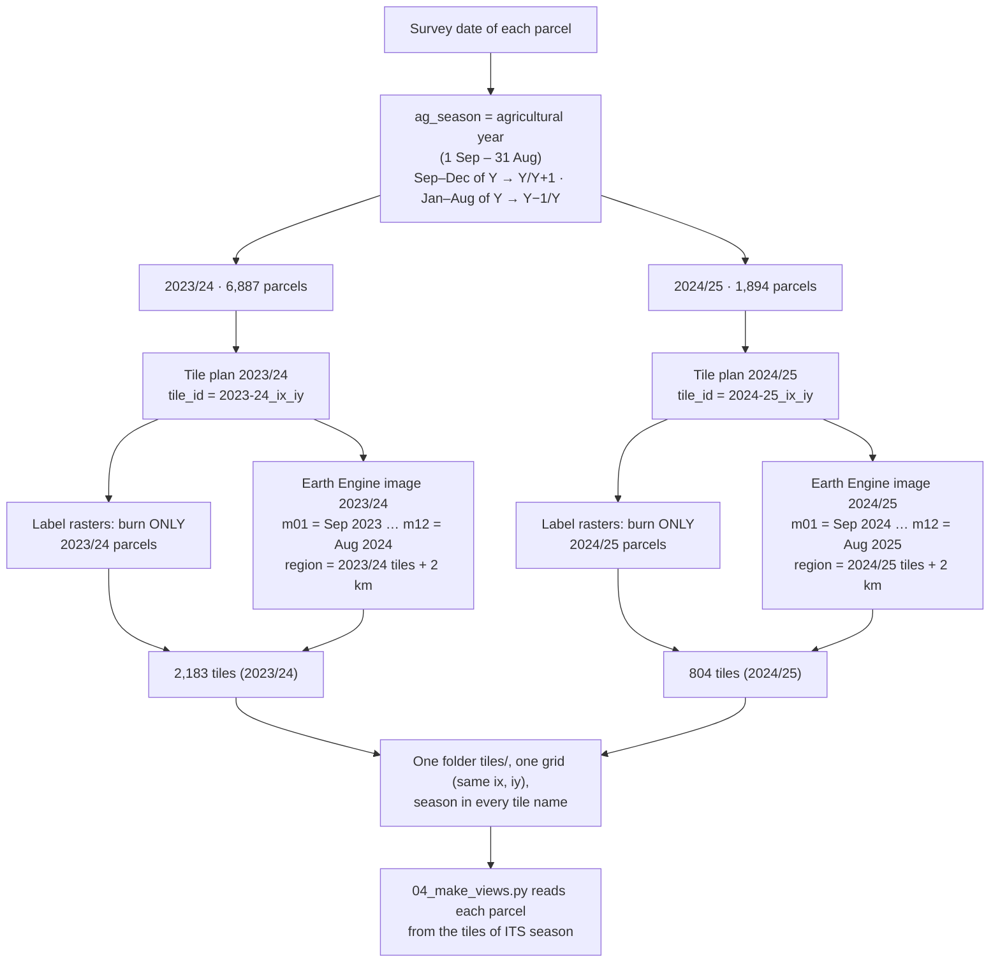
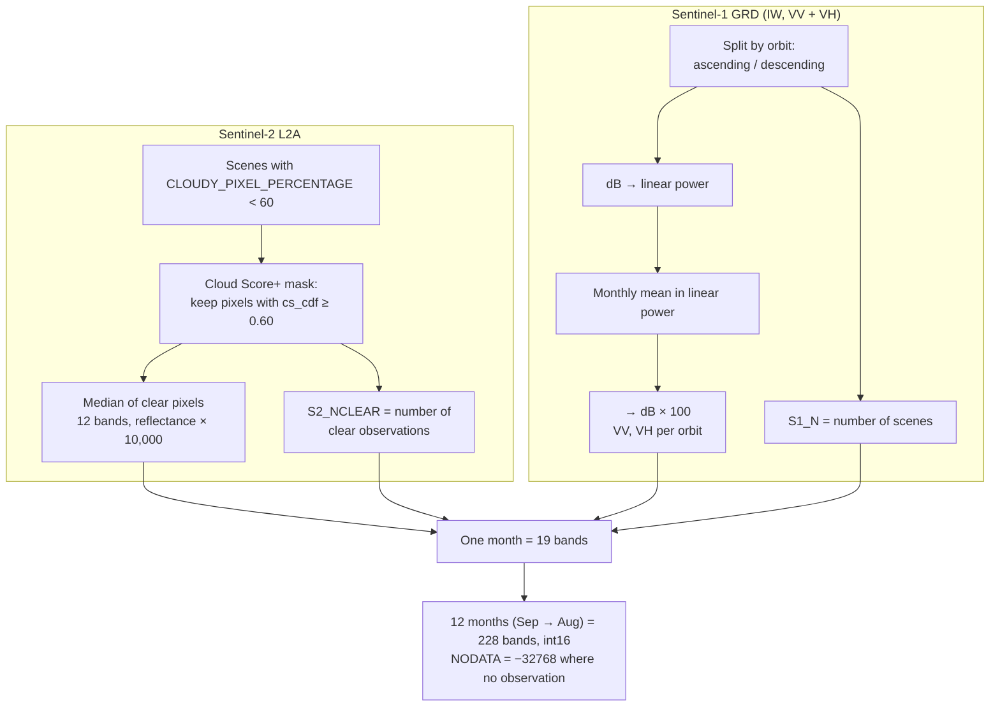
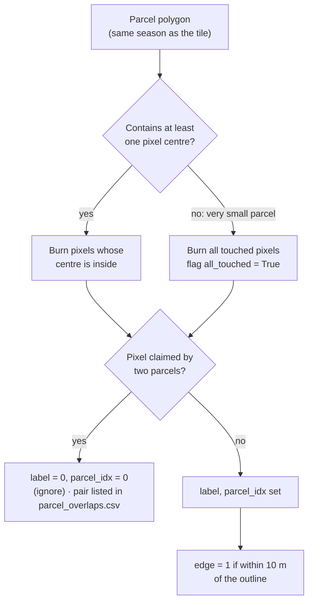
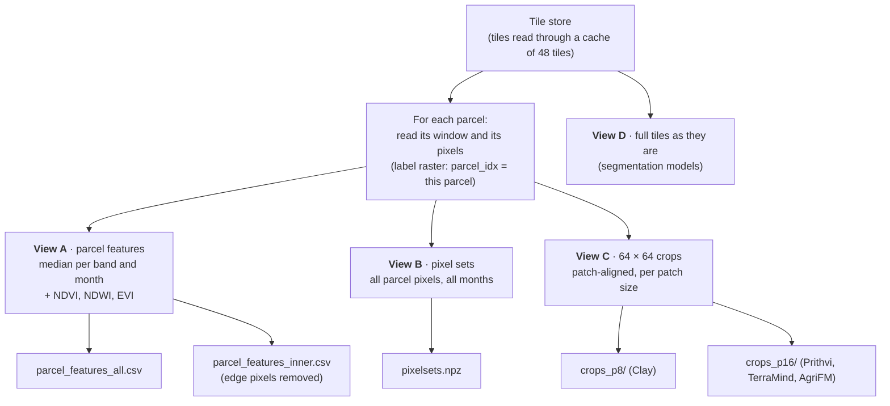
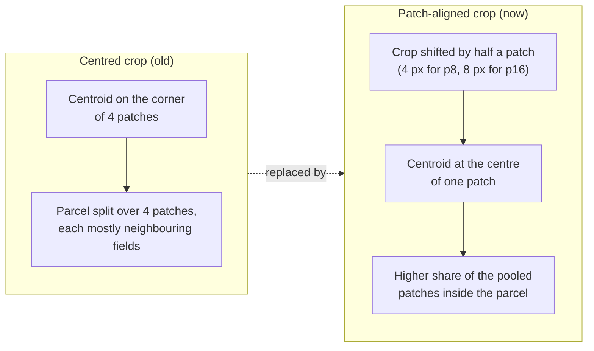

# Part 1 — ML-ready dataset of irrigated and rainfed parcels in Morocco

This folder builds the **training dataset**: labelled parcels, spatial train / validation / test
folds, and one shared store of monthly Sentinel-1/2 imagery with label rasters, plus ready-made
views for any kind of model. The dataset is independent of the study in `models_run/` and can be
published on its own.

**Contents**

1. [Overview](#1-overview)
2. [Design principles](#2-design-principles)
3. [Source data](#3-source-data)
4. [Script 01 — labels](#4-script-01--prepare_labels)
5. [Script 02 — spatial folds](#5-script-02--make_spatial_folds)
6. [Script 03 — tile store](#6-script-03--build_tiles)
7. [Script 04 — model views](#7-script-04--make_views)
8. [Output layout and file formats](#8-output-layout-and-file-formats)
9. [How to use the dataset](#9-how-to-use-the-dataset)
10. [Running, settings and run time](#10-running-settings-and-run-time)
11. [Known limitations](#11-known-limitations)
12. [References](#12-references)

---

## 1. Overview



| Step | Script | Earth Engine | What comes out |
| --- | --- | --- | --- |
| 1 | `01_prepare_labels.py` | no | 8,781 labelled cropland parcels (7,585 irrigated, 1,196 rainfed) |
| 2 | `02_make_spatial_folds.py` | no | a fold (0–4) per parcel, from 91 spatial blocks of 20 km |
| 3 | `03_build_tiles.py` | **yes** | the tile store: monthly images + label rasters + QA |
| 4 | `04_make_views.py` | no | model inputs A–C (D = the tiles themselves) |

Steps 1–2 take minutes. Step 3 takes a few hours, and it picks up where it stopped if restarted. Step 4 runs locally.

---

## 2. Design principles

| Principle | How it is achieved |
| --- | --- |
| **One set of pixels for every model** | All imagery is downloaded once into one tile store. Every model input is cut from it locally, so differences between models cannot come from different compositing, masks or download windows. |
| **No duplicated downloads** | Fixed, non-overlapping 1.28 km tiles in one projection. Neighbouring parcels share tiles instead of each getting its own overlapping chip. |
| **Imagery matched to the label date** | Each parcel gets the 12 months of the agricultural year (1 Sep – 31 Aug) in which it was surveyed. The same place in another year is a different tile. |
| **Honest validation** | Folds are made of whole 20 km blocks, so a test parcel never has its next-door neighbour in training (section 5). |
| **Uncertain pixels kept, not dropped** | Label 0 = ignore (unlabelled or overlapping parcels), plus a separate edge flag for mixed boundary pixels. Users decide how to treat them. |
| **Documented quality** | Clear-observation counts per pixel and month, scene IDs per tile and month, QA per tile, overlap list, patch-purity scores. |
| **Patch-aware crops** | Crops for patch-based models are shifted so the parcel centroid sits at the centre of one model patch (section 7). |

The layout follows existing ML-ready crop datasets. PASTIS (Garnot & Landrieu 2021) and Sen4AgriNet (Sykas et al. 2022) use fixed tiles with dense label and parcel-ID rasters. Fields of The World (Kerner et al. 2025) keeps an "unlabelled" ignore class. The ClarkCGA / Prithvi crop chips report QA counts per chip.

---

## 3. Source data

| Data | Use | Details |
| --- | --- | --- |
| Field survey (Ouassanouan et al. 2026, *Scientific Data*) | labels | ~10,000 parcel polygons, surveyed Dec 2023 – Jan 2025 in the Gharb, Tadla, Doukkala, El Haouz and Souss irrigation districts; land use, crop and irrigation method |
| GADM 4.1 Morocco | maps | country outline |
| ESA WorldCover 2021 (10 m) | label check | share of each parcel mapped as cropland |
| Sentinel-2 L2A harmonised (`COPERNICUS/S2_SR_HARMONIZED`) | imagery | 12 bands, surface reflectance |
| Cloud Score+ (`GOOGLE/CLOUD_SCORE_PLUS/V1/S2_HARMONIZED`) | cloud mask | `cs_cdf` ≥ 0.60 kept |
| Sentinel-1 GRD (`COPERNICUS/S1_GRD`) | imagery | IW mode, VV + VH, ascending and descending kept apart |

---

## 4. Script 01 — `prepare_labels`

**Purpose:** turn the raw survey into one clean file of labelled cropland parcels. Every later step starts from this file.



**Steps**

1. Read the survey shapefile.
2. Clean the geometry: drop parcels without geometry, repair invalid polygons, drop exact duplicates.
3. Label it: any irrigation method (drip, flood, sprinkler, basin, pivot) = **1 irrigated**; "rainfed" = **2 rainfed**. Spelling variants are normalised.
4. Keep cropland only: *Seasonal Crop*, *Trees*, *Trees + Seasonal*.
5. Add these attributes:
   - `area_ha`: area in UTM 29N.
   - `ag_season`: agricultural year of the survey date (1 Sep – 31 Aug, e.g. `2023/24`). This decides which imagery a parcel gets.
   - `nn_dist_m`: distance to the nearest other parcel.
   - `wc_cropland_frac`, `wc_major`: optional WorldCover check (`CHECK_WORLDCOVER`).
6. Save the parcels, a summary table and four figures.

**Result**

| Agricultural year | Irrigated | Rainfed | Total |
| --- | ---: | ---: | ---: |
| 2023/24 | 6,189 (11,034 ha) | 698 (836 ha) | 6,887 |
| 2024/25 | 1,396 (2,020 ha) | 498 (1,286 ha) | 1,894 |
| **All** | **7,585** | **1,196** | **8,781** |

Median parcel size: 0.83 ha (10th–90th percentile: 0.30–3.5 ha). Rainfed parcels are 14% of the total, and nearly all of them (1,122 of 1,196) are in Doukkala. The classes are unbalanced, and the class is partly tied to the region, which is why section 5 matters.

**Outputs** (`outputs/dataset/01_labels/`):
- `parcels_labelled.geojson`
- `summary.csv`
- `parcels_map.png`
- `class_balance_and_size.png`
- `survey_timing.png`

---

## 5. Script 02 — `make_spatial_folds`

**Purpose:** split the parcels into 5 folds so a model can be trained on some areas and tested on **other** areas. This is the dataset's train / validation / test split.

### 5.1 Why not a random split

Surveyed parcels lie a few hundred metres apart, and neighbours usually share a class. With a random 5-fold split, 72% of test parcels have a training parcel within 250 m, and 98% within 1 km. The score then measures how well the model recognises nearby fields, not how well it maps new areas. This problem is described by Roberts et al. (2017), Ploton et al. (2020) and Kattenborn et al. (2022).

### 5.2 Choosing the block size

How far does spatial dependence reach? Take pairs of parcels at a given distance and count how often they share a class. Compare that with the **random-placement level**: the probability that two parcels drawn at random share a class, 0.86² + 0.14² ≈ **76%**. Once the curve falls to that level, distance no longer tells you anything about the class.

| Distance between parcels | 0.2 km | 1 km | 5 km | 10 km | 15 km | 20 km | 30 km | 50 km |
| --- | --- | --- | --- | --- | --- | --- | --- | --- |
| Same class (%) | 96.1 | 95.2 | 92.0 | 91.0 | 86.7 | 81.4 | 79.7 | 73.7 |

Candidate block sizes, each with 5 greedy-balanced folds:

| Split | Rainfed in smallest fold | Rainfed share per fold | Test parcels with a training parcel ≤ 250 m | ≤ 1 km |
| --- | ---: | --- | ---: | ---: |
| random | 239 | 20–20% | 79.4% | 98.4% |
| 2 km blocks | 239 | 20–20% | 12.8% | 65.6% |
| 5 km | 239 | 20–20% | 6.3% | 31.7% |
| 10 km | 239 | 20–20% | 3.2% | 18.0% |
| **20 km** | **238** | **20–20%** | **2.0%** | **10.2%** |
| 25 km | 239 | 20–20% | 1.8% | 9.1% |
| 30 km | 142 | 12–34% | 0.6% | 4.6% |
| 50 km | 202 | 17–24% | 1.2% | 5.9% |

**20 km** is the chosen size:
- It is near the distance where class similarity approaches the random-placement level.
- It cuts leakage to 2% at 250 m.
- It still gives five folds with equal class shares.

From 30 km upwards there are too few blocks with rainfed parcels to balance the folds: one fold would hold 12% of the rainfed parcels and another 34%.

### 5.3 Fold assignment



Resulting folds (whole blocks per fold):

| Fold | Irrigated | Rainfed | Blocks |
| --- | ---: | ---: | ---: |
| 0 | 1,528 | 239 | 12 |
| 1 | 1,528 | 239 | 13 |
| 2 | 1,473 | 241 | 42 |
| 3 | 1,528 | 238 | 11 |
| 4 | 1,528 | 239 | 13 |

Leakage, all folds averaged:

| Training parcel within … | 100 m | 250 m | 500 m | 1 km | 5 km |
| --- | ---: | ---: | ---: | ---: | ---: |
| random split | 24.1% | 71.7% | 90.1% | 97.7% | 99.7% |
| 20 km spatial split | 0.4% | 1.8% | 3.8% | 8.1% | 38.0% |

### 5.4 How the folds give train, validation and test

There is no single fixed train / validation / test split. The folds take turns, in a **nested spatial cross-validation**:



For quick experiments, the column `split` gives one fixed split: fold 0 = test, fold 1 = validation, folds 2–4 = train. `random_fold` gives a stratified random split, so the optimism of random validation can be measured.

**Outputs** (`outputs/dataset/02_folds/`):
- `parcels_folds.geojson`: parcels + `block_id`, `fold`, `random_fold`, `split`
- `fold_counts.csv`
- `block_size_comparison.csv`
- `class_similarity_by_distance.csv` / `.png`
- `leakage_check.csv`
- `spatial_folds.png`, `spatial_folds_blocks.png`
- `train_test_distance.png`

---

## 6. Script 03 — `build_tiles`

**Purpose:** build the single image store that every model reads from.

### 6.1 Tile grid and which tiles are built

- One projection for the whole area, UTM 29N (EPSG:32629), with 10 m pixels. The few parcels in zone 30N are resampled.
- A fixed grid of **128 × 128-pixel tiles (1.28 km × 1.28 km)**. Tile IDs are `<season>_<ix>_<iy>`, e.g. `2023-24_412_3561`.
- Only the tiles the parcels need are built:
  - **home** tile: holds the parcel centroid;
  - **outline** tiles: touched by the parcel polygon;
  - **context** tiles: reached by the largest model crop around the centroid. That is 64 px plus up to 8 px of alignment shift, i.e. 40 px (400 m) in every direction.



### 6.2 Two agricultural years

The survey ran from December 2023 to January 2025, so the parcels belong to two agricultural years. Each parcel must be described by the imagery of the season in which its label was observed. A field that was irrigated in 2023/24 may be rainfed or fallow in 2024/25. The two years are therefore handled as two separate, parallel tile stores that share one grid:



How each part of the pipeline handles the season:

| Where | How the season is handled |
| --- | --- |
| `01_prepare_labels.py` | `ag_season` from the survey date: 1 Sep – 31 Aug (a parcel surveyed in Jan 2024 → `2023/24`; Dec 2024 → `2024/25`) |
| Tile plan | a tile is the triple (season, ix, iy). The same 1.28 km square can exist once for each year, with the same grid position. |
| Tile name | the season comes first: `2023-24_374_2793`, `2024-25_374_2793` |
| Label rasters | only parcels of the tile's own year are burnt in, so a 2024/25 parcel never appears as a label in a 2023/24 tile |
| Imagery | one 12-month Earth Engine image per year, built over that year's tiles only. The month bands are named identically (`m01` … `m12`), so both years have the same 228-band layout and models can mix them. |
| QA, `tiles.parquet` | one row per (season, tile), with an `ag_season` column |
| Views (`04_make_views.py`) | every parcel is cut from the tiles of its own season; `ag_season` is kept in every output table |
| Folds (`02`) | blocks are defined by location only, so a place surveyed in both years falls in the **same** block and fold. No information leaks between years from training to test. |
| Viewing (`tools/a4_build_vrt.py`) | one virtual raster per year, because the two years overlap in space |

Currently 47 tile positions exist in both years: places with parcels surveyed in 2023/24 and in 2024/25.

Why calendar months are aligned to the agricultural year, not to a calendar year: the rainfed cycle (sowing in Nov–Dec, peak in Feb–Mar, harvest in May) and summer irrigation (Jun–Aug) both fall inside one Sep–Aug window. A Jan–Dec window would cut the rainfed season in two.

### 6.3 Monthly composites (per tile, per month)



- **19 bands per month:**
  - B1, B2, B3, B4, B5, B6, B7, B8, B8A, B9, B11, B12
  - S2_NCLEAR
  - VV_ASC, VH_ASC, S1_N_ASC
  - VV_DSC, VH_DSC, S1_N_DSC
- **Months:** `m01` = September … `m12` = August of the parcel's agricultural year. Band names in the GeoTIFF look like `B4_m03` (red, November).
- **Why linear power for Sentinel-1:** backscatter in dB is a logarithm. Averaging in dB gives the geometric mean and biases the composite downwards. Averaging is therefore done in linear power, and the result converted back to dB.
- **Why the orbits are kept apart:** ascending and descending passes look at a field from different incidence angles, so their backscatter is not interchangeable. Both are stored, and the view script picks one.
- Each tile's `_scenes.json` lists the Sentinel-1/2 scene IDs used in each month, so every pixel can be traced to its source.

### 6.4 Label rasters (local, no Earth Engine)

Each tile has a 3-band `int32` label raster on exactly the same grid:

| Band | Values | Meaning |
| --- | --- | --- |
| `label` | 0 / 1 / 2 | 0 = unlabelled or ignore, 1 = irrigated, 2 = rainfed |
| `parcel_idx` | 0 / 1…N | 0 = no parcel, otherwise the parcel's row in `parcels.csv` |
| `edge` | 0 / 1 | 1 = parcel pixel within 10 m of the outline (mixed boundary pixel) |

Rules:



Only parcels of the tile's own agricultural year are burnt in.

### 6.5 Steps

1. Read the parcels with folds and project them to UTM 29N.
2. Parcel table: index, centroid, bounds, area, perimeter, pixel counts (all and inner), home tile, tiles needed.
3. Tile plan (6.1).
4. Label rasters for all planned tiles (6.3). Local and fast.
5. Earth Engine: one 228-band monthly image per agricultural year. Each tile is downloaded with `computePixels`, 8 requests in parallel and up to 4 retries, and written as a compressed GeoTIFF with its scene IDs. Finished tiles are skipped on a restart.
6. Tile index (`tiles.parquet`) with fold, role, labelled pixels and QA.

`DOWNLOAD = False` stops after step 4, so the plan and labels can be checked without Earth Engine. `N_TEST_TILES = 20` builds only 20 tiles per season, for a test run.

### 6.6 Quality numbers per tile

| Column | Meaning |
| --- | --- |
| `s2_nodata_pct` | share of tile-months without any clear Sentinel-2 pixel |
| `s2_nodata_parcel_pct` | the same, on parcel pixels only |
| `s2_nclear_parcel_median` | median number of clear observations on parcel pixels, per month |
| `s1_asc_months`, `s1_dsc_months` | months with at least one ascending / descending scene |
| `role` | home, outline or context |
| `mixed_folds` | the tile holds parcels from more than one fold (relevant for segmentation, section 11) |

**Outputs** (`outputs/dataset/03_tiles/agyear/`):
- `tiles/<id>_img.tif`, `tiles/<id>_lab.tif`, `tiles/<id>_scenes.json`
- `parcels.csv`
- `parcel_overlaps.csv`
- `tiles.parquet`
- `tiles_qa.jsonl`
- `tiles_info.json`

---

## 7. Script 04 — `make_views`

**Purpose:** cut every model input from the tile store. It runs locally and needs no Earth Engine.



### 7.1 View A — parcel feature tables

- Per parcel and month: the **median** over the parcel's pixels of each of these:
  - the 12 Sentinel-2 bands (reflectance 0–1);
  - NDVI = (B8 − B4)/(B8 + B4);
  - NDWI = (B8 − B11)/(B8 + B11), which measures canopy water;
  - EVI = 2.5 (B8 − B4)/(B8 + 6 B4 − 7.5 B2 + 1);
  - VV and VH for both orbits (dB).
- Indices are computed per pixel first, then the median is taken.
- The median is used instead of the mean because it is robust to leftover clouds and mixed edge pixels.
- Observation counts are added: the mean S2_NCLEAR over the parcel, and the maximum S1_N per orbit.
- Column names are `<variable>_m<month>`, e.g. `NDVI_m10` (NDVI in June). Each parcel has 19 variables × 12 months = 228 feature columns, plus counts and metadata (`parcel_id`, `label`, `ag_season`, `fold`, `n_px_used`, `used_inner`).
- `parcel_features_inner.csv` leaves out edge pixels. A parcel with no inner pixel falls back to all of its pixels (`used_inner = False`).

### 7.2 View B — pixel sets

All pixels of each parcel, unaggregated, for set-based temporal models such as PSE-TAE (Garnot et al. 2020).

- `pixels [N_pixels, 12, bands]` int16
- `offsets [parcels + 1]`: parcel *i* = `pixels[offsets[i]:offsets[i+1]]`
- `edge [N_pixels]`, `parcel_id`, `label`, `bands`

### 7.3 View C — patch-aligned crops for the foundation models

Vision-transformer foundation models split an image into square patches: 8 × 8 px for Clay, and 16 × 16 px (160 m) for Prithvi-EO-2.0, TerraMind and AgriFM's output grid. Each patch gets one embedding.

If the crop is simply centred on the parcel, and its size is a multiple of the patch size, the centroid falls on the **corner** of four patches. A small parcel is then split across four patches that are mostly neighbouring fields. Shifting the crop by half a patch puts the centroid at the **centre** of one patch:



**Purity** measures this. A patch's weight is the share of its pixels inside the parcel, and those weights are also what the study uses to pool patch embeddings. Purity is the weighted share of parcel pixels in the pooled patches: Σ w² / Σ w, from 0 to 1. `index.csv` stores both `purity` (aligned) and `purity_centred` (old rule), so the gain is measurable.

Each crop folder holds:
- `part_*.npz`: `chips [n, 12, 15, 64, 64]` int16, `mask [n, 64, 64]` (parcel pixels), `parcel_id`.
- `index.csv`: one row per parcel. Columns: `part`, `label`, `ag_season`, `fold`, `zone`, `lat`, `lon`, `epsg`, `x0`, `y0` (crop top-left corner, for georeferencing), `area_ha`, `n_px`, `n_px_in_crop`, `purity`, `purity_centred`.
- `chips_info.json`: band order and scales. The 15 bands are B1 … B12, VV, VH, S2_NCLEAR.

### 7.4 Sentinel-1 orbit for views B and C

`S1_ORBIT = "auto"` picks the orbit direction with more valid tile-months over the whole study area and writes it to `views_info.json` (`s1_orbit_for_crops_and_pixelsets`). That orbit's bands are named simply `VV` and `VH` in the crops. `"ASC"` or `"DSC"` force one orbit. View A keeps both orbits as separate columns.

### 7.5 QA files

- `qa_clear_obs.csv`: clear observations per parcel and month.
- `qa_purity.csv`: purity distribution per patch size.
- `views_info.json`: settings, the chosen orbit, and counts.

---

## 8. Output layout and file formats

```
outputs/dataset/
├── 01_labels/
│   ├── parcels_labelled.geojson         EPSG:4326 polygons
│   └── summary.csv, *.png
├── 02_folds/
│   ├── parcels_folds.geojson            + block_id, fold, random_fold, split
│   └── fold_counts.csv, block_size_comparison.csv, leakage_check.csv, class_similarity_by_distance.csv, *.png
└── 03_tiles/agyear/
    ├── tiles/
    │   ├── <tile_id>_img.tif            int16, 228 bands (12 months × 19), NODATA −32768, EPSG:32629, 10 m
    │   ├── <tile_id>_lab.tif            int32, 3 bands: label, parcel_idx, edge
    │   └── <tile_id>_scenes.json        scene IDs per month (S2, S1 asc, S1 dsc)
    ├── parcels.csv                      one row per parcel (parcel_idx = value in the label raster)
    ├── parcel_overlaps.csv              overlapping parcel pairs, their labels and overlap share
    ├── tiles.parquet                    GeoParquet tile index: geometry, season, role, fold(s), QA
    ├── tiles_info.json                  grid, bands, months, scales, cloud settings
    └── views/
        ├── parcel_features_all.csv      view A
        ├── parcel_features_inner.csv    view A, edge pixels removed
        ├── pixelsets.npz                view B
        ├── crops_p8/  crops_p16/        view C: part_*.npz, index.csv, chips_info.json
        ├── qa_purity.csv, qa_clear_obs.csv
        └── views_info.json
```

**Scales:**
- Sentinel-2: reflectance × 10,000.
- Sentinel-1: dB × 100. For example, −1,523 = −15.23 dB.
- Counts: plain integers.
- −32,768 = no observation. Count bands are 0 there.

---

## 9. How to use the dataset

| Model family | Use | Train / validation / test |
| --- | --- | --- |
| Random forest, gradient boosting, SVM | View A | `fold` (nested CV) or `split` |
| Pixel-set temporal models (PSE-TAE, L-TAE) | View B | same |
| Foundation models / any CNN or ViT on chips | View C (`crops_p8` or `crops_p16`) with `mask` | same, from `index.csv` |
| Segmentation (U-Net, U-TAE) | View D: `_img.tif` + `_lab.tif`, loss masked where `label = 0` | split by **tile**, using `tiles.parquet` (`fold`, `mixed_folds`) |

Minimal example: read the crops.

```python
import json, numpy as np, pandas as pd
folder = "outputs/dataset/03_tiles/agyear/views/crops_p16"
index = pd.read_csv(f"{folder}/index.csv", dtype={"parcel_id": str})
info = json.load(open(f"{folder}/chips_info.json"))
d = np.load(f"{folder}/{index.part.iloc[0]}")
chips, mask = d["chips"], d["mask"]            # [n, 12, 15, 64, 64], [n, 64, 64]
red_june = chips[0, 9, info["bands"].index("B4")] / 10000
```

---

## 10. Running, settings and run time

```bash
conda activate condaml
python ml_dataset_prep/01_prepare_labels.py          # minutes
python ml_dataset_prep/02_make_spatial_folds.py      # minutes
python ml_dataset_prep/03_build_tiles.py             # Earth Engine; a few hours; resumable
python ml_dataset_prep/04_make_views.py              # local
```

Run 03 first with `N_TEST_TILES = 20`, then check the result with `models_run/01_inspect_dataset.py` and `tools/a3_export_chips_geotiff.py` (QGIS) before the full run.

To view the whole tile store as one layer, `tools/a4_build_vrt.py` writes virtual rasters (one per agricultural year: labels, true / false colour and Sentinel-1 per month) to `outputs/dataset/03_tiles/agyear/vrt/`. They only point to the tiles, so nothing is copied.

The settings sit at the top of each script:

| Script | Main settings |
| --- | --- |
| 01 | `SEASON_START_MONTH = 9`, `CROP_KEEP`, `IRRIGATED_TEXT`, `RAINFED_TEXT`, `CHECK_WORLDCOVER` |
| 02 | `N_FOLDS = 5`, `BLOCK_KM = 20`, `CANDIDATE_KM`, `SEED = 42` |
| 03 | `TILE_PX = 128`, `GSD_M = 10`, `CRS_EPSG = 32629`, `CROP_PX = 64`, `MAX_SHIFT_PX = 8`, `INNER_BUFFER_M = 10`, `CLOUD_COVER_PERCENTAGE = 60`, `CS_THRESHOLD = 0.60`, `DOWNLOAD`, `DOWNLOAD_WORKERS = 8`, `N_TEST_TILES` |
| 04 | `CROP_PATCH_SIZES = [8, 16]`, `CROP_PX = 64`, `S1_ORBIT = "auto"`, `MAKE_FEATURES`, `MAKE_PIXELSETS` |

Earth Engine access uses a service-account key in `secrets/`, which is never committed.

---

## 11. Known limitations

- **Class balance and geography:** 14% of parcels are rainfed, and 94% of those are in Doukkala. A model can partly learn "region" rather than "irrigation". Per-zone results should be reported.
- **Reprojection:** the few parcels in UTM 30N are resampled to 29N.
- **Monthly composites:** in cloudy winter months some parcels have no clear Sentinel-2 view (NODATA). The counts show where.
- **Segmentation with view D:** a tile can hold parcels of two folds (`mixed_folds`), and context tiles reach across fold borders. Tile-level models need their own tile split, or a loss mask restricted to the training fold.
- **Labels:** a single survey visit per parcel. Overlapping parcels are set to ignore and listed, but labels are not otherwise checked against imagery.

---

## 12. References

- Garnot, V. S. F., Landrieu, L., Giordano, S., & Chehata, N. (2020). Satellite image time series classification with pixel-set encoders and temporal self-attention. *CVPR*.
- Garnot, V. S. F., & Landrieu, L. (2021). Panoptic segmentation of satellite image time series with convolutional temporal attention networks (PASTIS). *ICCV*.
- Kattenborn, T., Schiefer, F., Frey, J., Feilhauer, H., Mahecha, M. D., & Dormann, C. F. (2022). Spatially autocorrelated training and validation samples inflate performance assessment of convolutional neural networks. *ISPRS Open Journal of Photogrammetry and Remote Sensing*, 5, 100018.
- Kerner, H., et al. (2025). Fields of The World: a machine learning benchmark dataset for global agricultural field boundary segmentation. *AAAI*.
- Ouassanouan et al. (2026). *Scientific Data* — field survey of the five irrigation districts (source of the labels). **TODO: add full author list, title and DOI from the published paper.**
- Ploton, P., et al. (2020). Spatial validation reveals poor predictive performance of large-scale ecological mapping models. *Nature Communications*, 11, 4540.
- Roberts, D. R., et al. (2017). Cross-validation strategies for data with temporal, spatial, hierarchical, or phylogenetic structure. *Ecography*, 40, 913–929.
- Sykas, D., Sdraka, M., Zografakis, D., & Papoutsis, I. (2022). A Sentinel-2 multiyear, multicountry benchmark dataset for crop classification and segmentation with deep learning (Sen4AgriNet). *IEEE JSTARS*, 15, 3323–3339.
- Pasquarella, V. J., Brown, C. F., Czerwinski, W., & Rucklidge, W. J. (2023). Comprehensive quality assessment of optical satellite imagery using weakly supervised video learning (Cloud Score+). *CVPR Workshops*.
