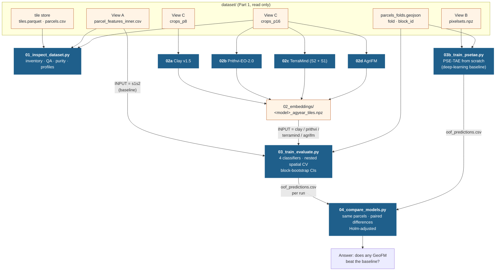
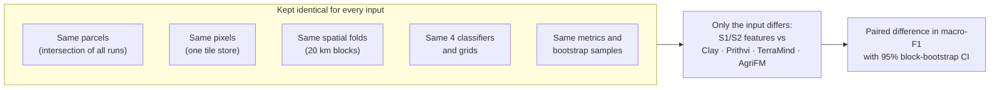
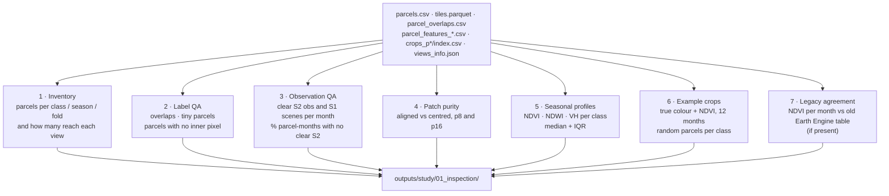
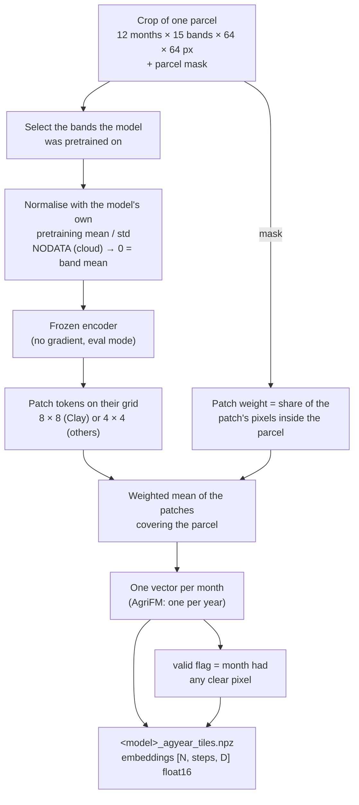
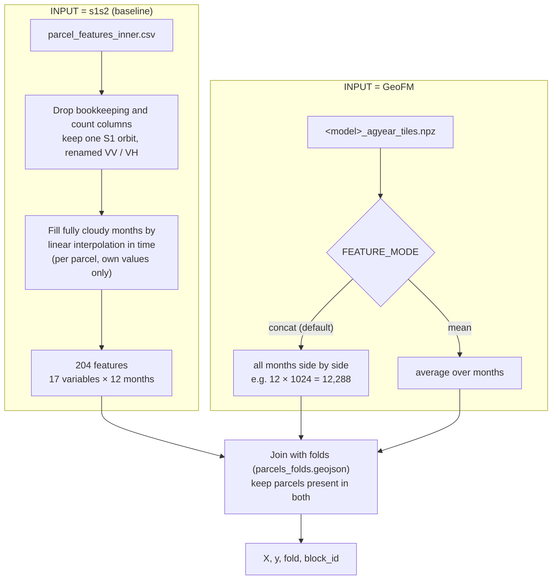
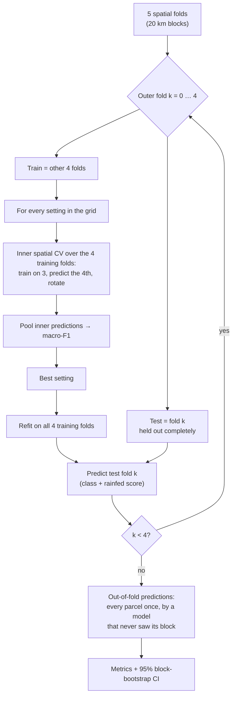
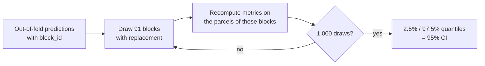
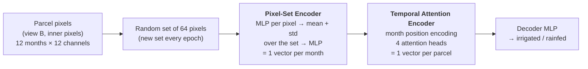
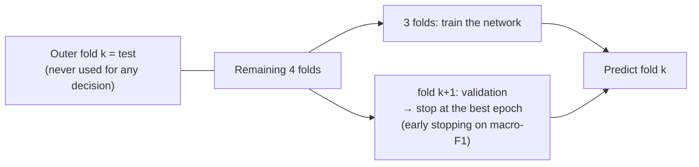
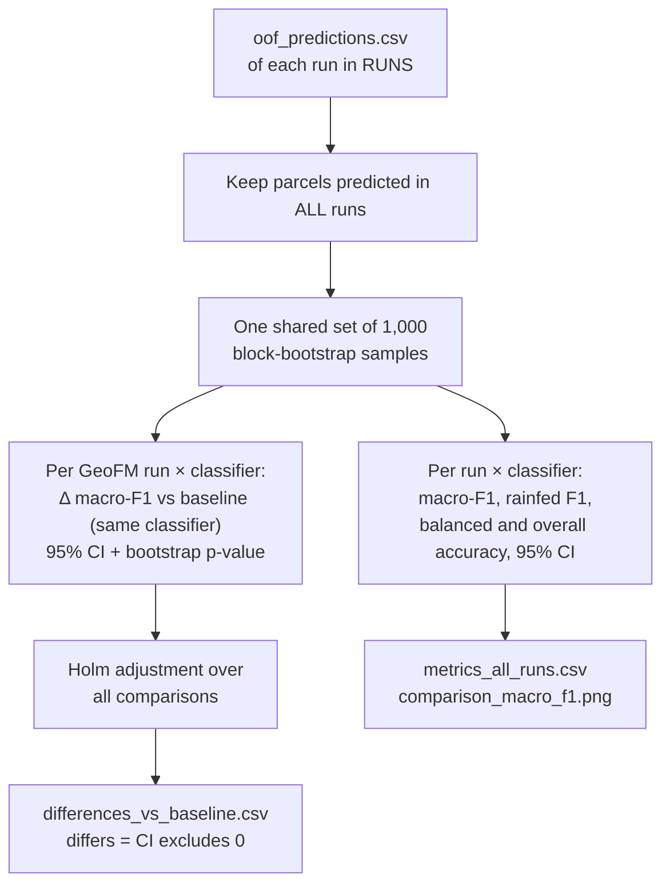

# Irrigated cropland mapping with geospatial foundation models

This folder holds the scripts that answers one question: on Moroccan parcels, does the frozen embedding of a geospatial foundation model (GeoFM) separate **irrigated** from **rainfed** cropland better than a classic Sentinel-1/2 feature baseline, under the same spatial validation?

It only reads the ML-ready dataset built in [`ml_dataset_prep/`](../ml_dataset_prep/README.md).

**Contents**

1. [Overview](#1-overview)
2. [Research questions and design](#2-research-questions-and-design)
3. [Inputs compared](#3-inputs-compared)
4. [Script 01 — inspect the dataset](#4-script-01--inspect_dataset)
5. [Scripts 02a–02d — foundation-model embeddings](#5-scripts-02a02d--foundation-model-embeddings)
6. [Script 03 — train and evaluate](#6-script-03--train_evaluate)
7. [Script 04 — compare inputs](#7-script-04--compare_models)
8. [Output layout](#8-output-layout)
9. [Running, settings and run time](#9-running-settings-and-run-time)
10. [Choices to report and open points](#10-choices-to-report-and-open-points)
11. [References](#11-references)

---

## 1. Overview



| Step | Script | GPU | What it does |
| --- | --- | --- | --- |
| 1 | `01_inspect_dataset.py` | no | checks the dataset before any model is trained |
| 2 | `02a_embed_clay.py` … `02d_embed_agrifm.py` | recommended | frozen GeoFM embeddings per parcel |
| 3 | `03_train_evaluate.py` | no | trains and evaluates the classifiers for one input (run once per input) |
| 3b | `03b_train_psetae.py` | recommended | deep-learning baseline: PSE-TAE trained from scratch on the parcels' pixels |
| 4 | `04_compare_models.py` | no | compares all inputs on the same parcels |

---

## 2. Research questions and design

1. **Main:** does a frozen GeoFM embedding classify irrigated vs rainfed parcels better than Sentinel-1/2 parcel features, when tested on areas the model has never seen?
2. Which GeoFM works best, and does the classifier on top matter?
3. How much does random cross-validation overstate accuracy compared with spatial cross-validation?
4. Which months (and, for the baseline, which variables) carry the signal?

The design keeps everything equal except the input:



The foundation models are used **frozen**, as feature extractors (linear-probe-style evaluation). They are not fine-tuned. This tests what the pretrained representation already contains, and it keeps the comparison cheap and fair.

---

## 3. Inputs compared

| Input | Source | Sensors | Patch / pixel unit | Time handling | Vector per parcel |
| --- | --- | --- | --- | --- | --- |
| **S1/S2 baseline** | View A, inner pixels | S2 (12 bands + NDVI, NDWI, EVI) + S1 VV, VH (one orbit) | parcel median | 12 months side by side | 17 variables × 12 months = 204 features |
| **Clay v1.5** | `crops_p8` | S2 (10 bands) | 8 × 8 px (80 m) | each month separately | 12 × 1024 |
| **Prithvi-EO-2.0-300M-TL** | `crops_p16` | S2 (6 HLS bands) | 16 × 16 px (160 m) | 4 months per pass, 3 passes | 12 × 1024 |
| **TerraMind-1.0-base** | `crops_p16` | S2 (12 bands) + S1 VV, VH | 16 × 16 px (160 m) | each month separately | 12 × 768 |
| **AgriFM** | `crops_p16` | S2 (10 bands) | output stride 16 px (160 m) | whole year in one pass | 1 × D |
| **PSE-TAE** (trained from scratch, no pretraining) | View B, pixel sets | S2 (10 bands) + S1 VV, VH | random set of 64 parcel pixels | temporal self-attention over 12 months | learned end to end |

**Only TerraMind uses Sentinel-1**, because it is the only one of the four models pretrained on radar. Clay, Prithvi and AgriFM receive optical bands only. To separate a "radar effect" from a "foundation-model effect", two sensitivity runs are possible:
- an **S2-only baseline** (`S1S2_VARIABLES = "s2"` in script 03);
- **TerraMind with optical only** (`MODALITIES = ["S2L2A"]` in 02c).

---

## 4. Script 01 — `inspect_dataset`

**Purpose:** find problems in the data before they show up as strange model results. It reads the dataset only and changes nothing.



What to look for:
- **Inventory:** all 8,781 parcels should reach view A and both crop folders. Missing parcels point to tiles that failed to download.
- **Observations:** winter months (Dec–Feb) have the fewest clear Sentinel-2 views. If a month is empty for most parcels, its features carry little information.
- **Purity:** the aligned crops should have a clearly higher median purity than the centred crops, especially for 16-px patches and small parcels.
- **Profiles:** rainfed parcels should peak in winter (around February) and be bare from May. Irrigated parcels should stay green, or green up again, in summer. This is the signal every model should find.
- **Legacy agreement:** high per-month correlation with the old Earth Engine NDVI confirms the new compositing. The old table used 30-day periods rather than calendar months, so the numbers will not be identical.

**Outputs:**
- `inventory.csv`
- `label_qa.csv`
- `observations_per_month.csv` / `.png`
- `purity_summary.csv`, `purity.png`
- `seasonal_profiles.png`
- `examples_irrigated.png`, `examples_rainfed.png`
- `legacy_agreement.csv`

For a closer look in QGIS, `tools/a3_export_chips_geotiff.py` writes single crops as georeferenced GeoTIFFs to `01_inspection/chips_geotiff/`.

---

## 5. Scripts 02a–02d — foundation-model embeddings

All four scripts follow the same pattern. Only the model, its bands and its normalisation change.



**Pooling.** Each patch token is weighted by the share of its pixels inside the parcel. Patches without any parcel pixel get weight 0. The parcel embedding is the weighted mean, so it describes the parcel and not the whole 640 m crop. The patch-aligned crops ([dataset §7.3](../ml_dataset_prep/README.md#73-view-c--patch-aligned-crops-for-the-foundation-models)) put most of the weight on one patch centred on the parcel.

**Cloudy pixels.** NODATA pixels are set to 0 after normalisation, which equals the band mean. A month with no clear pixel at all is flagged `valid = False`, and script 03 fills it with the training median.

**Resume.** Embeddings are saved in batches (`_parts_<model>_agyear_tiles/`) and merged at the end. A stopped run continues from the last batch.

### 5.1 `02a_embed_clay.py` — Clay v1.5

| | |
| --- | --- |
| Model | Clay v1.5, a masked-autoencoder ViT trained on Sentinel-2, Landsat, Sentinel-1, NAIP and others |
| Bands | B2 B3 B4 B5 B6 B7 B8 B8A B11 B12 (blue … swir22), Clay's band mean / std from `metadata.yaml` |
| Extra inputs | band wavelengths, pixel size (10 m), date (week of year and hour, sine/cosine; composites set to mid-month), location (lat/lon, sine/cosine) |
| Patch | 8 × 8 px = 80 m, so a 64 px crop gives an 8 × 8 grid |
| Time | one date per forward pass, so the 12 months are embedded separately |
| Output | `[N, 12, 1024]` |
| Weights | `checkpoints/clay/clay-v1.5.ckpt` |

### 5.2 `02b_embed_prithvi.py` — Prithvi-EO-2.0-300M-TL

| | |
| --- | --- |
| Model | Prithvi-EO-2.0-300M with temporal and location embeddings (IBM & NASA), pretrained on HLS time series |
| Bands | B2 B3 B4 B8A B11 B12 (HLS Blue, Green, Red, Narrow NIR, SWIR 1, SWIR 2), Prithvi's mean / std |
| Extra inputs | date (year, day of year) and location (lat, lon), `USE_COORDS = True` |
| Patch | 16 × 16 px; position encoding rescaled to 64 × 64 |
| Time | `FRAMES_PER_PASS = 4`, as in pretraining: Sep–Dec, Jan–Apr, May–Aug. Each frame keeps its own tokens, so there is still one vector per month. |
| Pixel size | pretrained on 30 m HLS; used here on 10 m Sentinel-2 (patch = 160 m, closer to parcel size than 480 m) |
| Output | `[N, 12, 1024]` |
| Loaded via | TerraTorch (`prithvi_eo_v2_300_tl`), weights from Hugging Face |

### 5.3 `02c_embed_terramind.py` — TerraMind-1.0-base

| | |
| --- | --- |
| Model | TerraMind-1.0-base (IBM & ESA), a multimodal any-to-any transformer pretrained on nine modalities |
| Inputs | `S2L2A`: B1 … B12 (12 bands); `S1GRD`: VV, VH in dB. Each is standardised with TerraMind's pretraining mean / std. |
| Fusion | tokens of the two modalities averaged (`merge_method = "mean"`) |
| Patch | 16 × 16 px, so a 4 × 4 grid |
| Time | one date per pass, 12 months separately |
| Output | `[N, 12, 768]` |
| Ablation | `MODALITIES = ["S2L2A"]` gives optical only |

### 5.4 `02d_embed_agrifm.py` — AgriFM

| | |
| --- | --- |
| Model | AgriFM, a modified Video Swin Transformer pretrained on MODIS, Landsat and Sentinel-2 time series for agriculture |
| Bands | B2 B3 B4 B5 B6 B7 B8 B8A B11 B12, normalised with the repository's `cropland_mapping.py` config |
| Time | the **whole 12-month stack in one pass**. Time is compressed inside the network, so the output is one vector per parcel. |
| Patch | (4 time steps, 2 × 2 px) at input; final feature map stride 16 px, so a 4 × 4 grid |
| Output | `[N, 1, D]`, steps = `["year"]` |
| Setup | code cloned to `external/AgriFM`, weights to `checkpoints/agrifm/AgriFM.pth` (automatic); only the encoder file is used, with mmengine registries |
| **Check** | the config's normalisation mean (e.g. 4179 for blue) is far above typical L2A values (~1100). Confirm the expected pixel scale with the authors before reporting. |

### 5.5 Embedding file format

```
outputs/study/02_embeddings/<model>_agyear_tiles.npz
    parcel_id [N]   label [N]   ag_season [N]
    steps [T]                    month names (Sep … Aug), or ["year"] for AgriFM
    embeddings [N, T, D]         float16
    valid [N, T]                 False = month without any clear pixel
```

---

## 6. Script 03 — `train_evaluate`

**Purpose:** one script for every input, so all inputs are evaluated in exactly the same way. Set `INPUT` at the top and run it once per input.

### 6.1 From input to feature matrix



**Preprocessing inside every model pipeline.** It is fitted on the training folds only, so no information leaks from the test fold:
- Baseline: median imputation of any remaining gap.
- Embeddings: median imputation of empty months, then standardisation. In `concat` mode, **PCA to 128 components** follows.

### 6.2 Classifiers and hyperparameter grids

| Name | Classifier | Grid (inner CV) | Notes |
| --- | --- | --- | --- |
| `logreg` | Logistic regression | C ∈ {0.01, 0.1, 1, 10} | `class_weight = "balanced"`, standardised. On embeddings this is the standard **linear probe**. |
| `rf` | Random forest | max_features ∈ {√p, 0.3}; min_samples_leaf ∈ {1, 5}; class_weight ∈ {none, balanced_subsample} | 500 trees |
| `hgb` | Histogram gradient boosting | learning_rate ∈ {0.05, 0.1}; max_leaf_nodes ∈ {15, 31}; class_weight ∈ {none, balanced} | |
| `svm` | RBF support vector machine | C ∈ {1, 10}; γ ∈ {scale, 0.01} | `class_weight = "balanced"`, standardised |

The selection score is macro-F1, the mean of the irrigated F1 and rainfed F1. It treats the 14% rainfed class as equally important.

### 6.3 Nested spatial cross-validation



Every parcel is predicted once, by a model that saw neither its block in training nor any information from it during tuning. That makes the score an estimate of how well the model maps **new areas**.

### 6.4 Metrics and uncertainty

| Metric | Why |
| --- | --- |
| **Macro-F1** (headline) | balances both classes; insensitive to the 86 / 14 split |
| F1, precision, recall per class | rainfed recall shows how many rainfed parcels are found |
| Balanced accuracy | mean recall of both classes |
| Overall accuracy | for comparison with the literature; the trivial "all irrigated" model already gets 86% |
| PR-AUC (rainfed) | threshold-free ranking quality for the minority class |
| Brier score, expected calibration error | quality of the predicted probabilities |

**95% confidence intervals: block bootstrap.** Parcels in one 20 km block are correlated, so blocks, not parcels, are the independent units. Each of the 1,000 draws resamples whole blocks with replacement and recomputes every metric. The 2.5% and 97.5% quantiles give the interval.



### 6.5 Further analyses in the same run

1. **Classifier comparison:** paired macro-F1 differences between the 4 classifiers on the same parcels, with block-bootstrap CIs.
2. **Spatial vs random CV:** the same hyperparameters re-evaluated with the stratified `random_fold`. The gap shows how much random validation overstates accuracy.
3. **Grouped permutation importance:** uses the random forest of each outer fold, on its test fold. For the baseline it is computed by variable (NDVI, VH, …) and by month; for embeddings, by month.
4. **Seasonal profiles** (baseline): class medians per variable and month.
5. **Final models:** refit on all parcels (`final_model_<name>.joblib`), for mapping later.

**Outputs** (`outputs/study/03_models/<RUN_NAME>/`):
- `metrics_summary.csv`, `metrics_with_ci.csv`, `metrics_per_fold.csv`
- `paired_model_differences.csv`
- `cv_random_vs_spatial.csv` / `.png`
- `oof_predictions.csv`
- `selected_hyperparameters.csv`, `inner_tuning_scores.csv`
- `importance.csv` / `.png`
- `confusion_matrices.png`
- `seasonal_profiles.png`, `gap_filling.csv` (baseline only)
- `final_model_*.joblib`
- `run_config.json`, `run.log`

**Run names:**
- Baseline: `s1s2-<variables>_agyear_tiles-<inner|all>-<orbit>`, e.g. `s1s2-all_agyear_tiles-inner-asc`.
- GeoFMs: `<model>_agyear_tiles_<concat|mean>`, e.g. `clay_agyear_tiles_concat`.

---

## 6b. Script 03b — `train_psetae` (deep-learning baseline)

**Purpose:** a deep model trained **from scratch** on the same parcels and pixels. It answers the question reviewers usually ask: is a pretrained foundation model better than a deep network trained directly on our own labels? Together with the feature baseline (script 03, `INPUT = "s1s2"`), it gives two reference points: a classic one and a deep-learning one.

**Model:** PSE-TAE ([Garnot et al. 2020, CVPR](https://arxiv.org/abs/1911.07757); [official code](https://github.com/VSainteuf/pytorch-psetae)), designed for parcel classification from satellite image time series.



| | |
| --- | --- |
| Channels | Sentinel-2 B2 B3 B4 B5 B6 B7 B8 B8A B11 B12 (the paper's 10 bands) + Sentinel-1 VV, VH of the crops' orbit (`BANDS = "s2"` for optical only) |
| Pixels | inner pixels only (edge pixels left out, as in the baseline features); parcels with fewer than 4 inner pixels keep all pixels |
| Architecture | paper defaults: MLP1 32-64, mean + std pooling, MLP2 128; 4 heads, d_k = 32, MLP3 512-128-128; decoder 64-32-2. The paper's extra geometric features are not used, so the model sees only pixels. |
| Training | Adam (lr 0.001, weight decay 0.0001), batch 128, up to 100 epochs, class-weighted cross-entropy for the 86 / 14 imbalance; band normalisation computed on the training pixels of each fold |
| Prediction | rainfed probability averaged over 5 random pixel sets |

**Validation:** the same 5 spatial folds as every other input.



There is no hyperparameter grid: the architecture and optimiser settings are fixed in advance (paper defaults). The inner validation fold is used only for early stopping. Unlike the classifiers of script 03, the network is not refit on all four training folds, because it needs the validation fold to know when to stop.

**Outputs** (`outputs/study/03_models/psetae_agyear_s2s1/`), in the same format as script 03, so script 04 picks the run up automatically:
- `oof_predictions.csv`
- `metrics_with_ci.csv`, `metrics_summary.csv`, `metrics_per_fold.csv`
- `training_history.csv` (loss and validation macro-F1 per epoch)
- `model_fold<k>.pt`, `run_config.json`, `run.log`

In script 04, PSE-TAE is compared with the baseline's random forest (`BASELINE_CLASSIFIER = "rf"`).

---

## 7. Script 04 — `compare_models`

**Purpose:** answer the main research question by comparing every input with the baseline, on the same parcels.



- **Paired:** the same bootstrap blocks are used for every run, so each difference is measured on identical resamples (Foody 2009).
- **Multiple comparisons:** 4 GeoFMs × 4 classifiers = 16 comparisons, Holm-adjusted.
- **Interpretation:** a GeoFM is better than the baseline only if the 95% interval of Δ macro-F1 lies entirely above 0.

`BASELINE_RUN` must match the orbit that was actually used (`views_info.json`), for example `s1s2-all_agyear_tiles-inner-asc`.

---

## 8. Output layout

```
outputs/study/
├── 01_inspection/                    script 01 (+ chips_geotiff/ from tools/a3)
├── 02_embeddings/
│   ├── clay_agyear_tiles.npz
│   ├── prithvi_agyear_tiles.npz
│   ├── terramind_agyear_tiles.npz
│   ├── agrifm_agyear_tiles.npz
│   └── _parts_<model>_agyear_tiles/  batch files (resume)
├── 03_models/
│   ├── s1s2-all_agyear_tiles-inner-asc/
│   ├── clay_agyear_tiles_concat/
│   └── …                             one folder per run
└── 04_comparison/
    ├── metrics_all_runs.csv
    ├── differences_vs_baseline.csv
    └── comparison_macro_f1.png
```

---

## 9. Running, settings and run time

```bash
conda activate condaml
python models_run/01_inspect_dataset.py
python models_run/02a_embed_clay.py          # GPU recommended; resumable
python models_run/02b_embed_prithvi.py
python models_run/02c_embed_terramind.py
python models_run/02d_embed_agrifm.py
# models_run/03: set INPUT at the top, run once for each of: s1s2, clay, prithvi, terramind, agrifm
python models_run/03_train_evaluate.py
python models_run/03b_train_psetae.py        # deep-learning baseline; GPU recommended
python models_run/04_compare_models.py
```

`QUICK_TEST = True` in script 03 gives a fast check: 100 trees, 100 bootstrap draws, one setting per classifier.

| Script | Main settings |
| --- | --- |
| 01 | `EXAMPLE_PATCH = 16`, `N_EXAMPLES = 3`, `SEED = 42` |
| 02a–02d | `CHIP_SOURCE = "tiles"`, `CROP_PATCH_PX` (8 Clay, 16 others), `BATCH_PARCELS`, `EMBED_BATCH`, `DEVICE`. Model-specific: `FRAMES_PER_PASS`, `USE_COORDS` (Prithvi); `MODALITIES` (TerraMind) |
| 03 | `INPUT`, `S1S2_VARIABLES` (all / s2 / s1), `TILE_FEATURES` (inner / all), `S1_ORBIT` (crops / ASC / DSC / both), `FEATURE_MODE` (concat / mean), `PCA_DIM = 128`, `RF_TREES = 500`, `N_BOOT = 1000`, `QUICK_TEST` |
| 03b | `BANDS` (s2s1 / s2), `USE_EDGE_PIXELS`, `N_PIXELS = 64`, `BATCH_SIZE = 128`, `MAX_EPOCHS = 100`, `PATIENCE = 15`, `LEARNING_RATE`, `EVAL_DRAWS = 5`, `QUICK_TEST` |
| 04 | `BASELINE_RUN`, `RUNS`, `BASELINE_CLASSIFIER = "rf"`, `N_BOOT = 1000`, `SEED = 42` |

---

## 10. Choices to report and open points

| Choice | Value | Reason |
| --- | --- | --- |
| Frozen encoders, no fine-tuning | all four GeoFMs | tests the pretrained representation; equal cost for all |
| Parcel pooling | patch-share-weighted mean | describes the parcel, not the surroundings |
| Crops | 64 × 64 px, patch-aligned | centroid at a patch centre (see dataset §7.3) |
| Time | 12 monthly composites, Sep–Aug | covers the winter rainfed cycle and summer irrigation |
| Embedding reduction | concat + PCA 128, fitted on training folds | keeps the timing information; same dimension for every model |
| Baseline features | inner-pixel medians, one S1 orbit | same orbit as the TerraMind crops |
| Validation | nested spatial CV, 20 km blocks | estimates mapping of unseen areas |
| Uncertainty | block bootstrap, Holm | blocks are the independent units |
| Deep-learning baseline | PSE-TAE from scratch, paper defaults, early stopping on the next fold | tests pretraining against learning from our own labels |

**Open points:**
- AgriFM normalisation scale (§5.4).
- Prithvi on 10 m instead of 30 m data.
- Late fusion of GeoFM embeddings with S1 features for the optical-only models.
- Results per zone, since rainfed parcels are concentrated in Doukkala.

---

## 11. References

- Garnot, V. S. F., Landrieu, L., Giordano, S., & Chehata, N. (2020). Satellite image time series classification with pixel-set encoders and temporal self-attention. *CVPR*, 12325–12334. https://arxiv.org/abs/1911.07757

- Clay Foundation (2024). Clay foundation model v1.5. https://huggingface.co/made-with-clay/Clay, doi:10.57967/hf/1537.
- Foody, G. M. (2009). Classification accuracy comparison: hypothesis tests and the use of confidence intervals in evaluations of difference, equivalence and non-inferiority. *Remote Sensing of Environment*, 113, 1658–1663.
- Holm, S. (1979). A simple sequentially rejective multiple test procedure. *Scandinavian Journal of Statistics*, 6, 65–70.
- Jakubik, J., et al. (2025). TerraMind: large-scale generative multimodality for Earth observation. arXiv:2504.11171.
- Li, W., et al. (2025). AgriFM: a multi-source temporal remote sensing foundation model for crop mapping. arXiv:2505.21357.
- Roberts, D. R., et al. (2017). Cross-validation strategies for data with temporal, spatial, hierarchical, or phylogenetic structure. *Ecography*, 40, 913–929.
- Szwarcman, D., et al. (2024). Prithvi-EO-2.0: a versatile multi-temporal foundation model for Earth observation applications. arXiv:2412.02732.
- Varma, S., & Simon, R. (2006). Bias in error estimation when using cross-validation for model selection. *BMC Bioinformatics*, 7, 91. (nested cross-validation)
